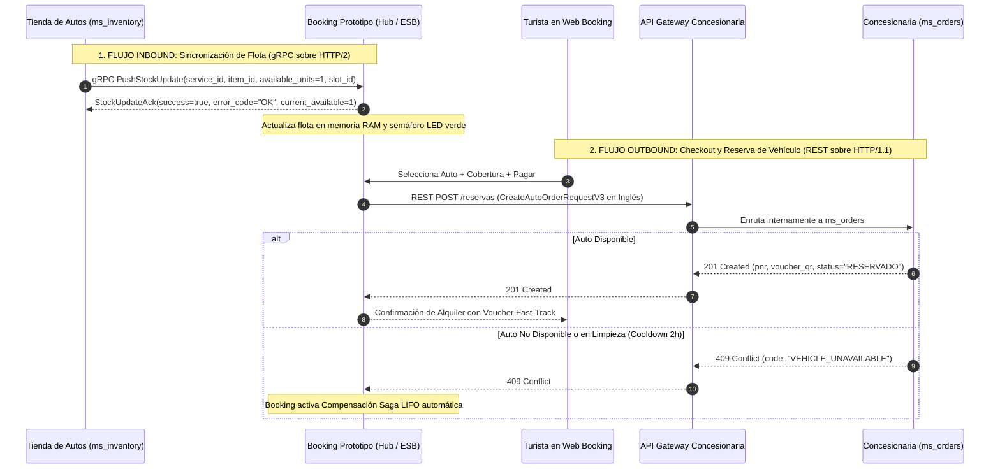

# Guía Oficial de Integración y Arquitectura — Vertical de Renta de Autos (RDA2 / Semana 9)

> **Documento:** Guía Técnica de Integración para Tiendas y Concesionarias de Renta de Autos  
> **Sistema Agregador Central:** Booking Prototipo (Marketplace Multimodal — Paúl Rosero)  
> **Contrato REST Canónico:** `contracts/autos-openapi-v3.yaml` (OpenAPI 3.0.3)  
> **Contrato gRPC Oficial:** `src/proto/inventory.proto` (Protocol Buffers v3 — Ingesta HTTP/2 Puerto 50051)  
> **Dashboard de Nodos:** `https://rda1-api.onrender.com/admin/dashboard` (Pestaña Nodos)  
> **RDA2 Criterio Excluyente (CE01):** *Todas las tiendas deben integrarse funcionalmente con Booking Prototipo para aprobar la materia (Rúbrica RDA2).*

---

## 1. Visión General de la Arquitectura de Integración

Al igual que en la vertical de Atracciones, la integración entre las **Tiendas Concesionarias de Autos** y el **Booking Prototipo Central** se rige por un **flujo asimétrico de comunicación** de alto rendimiento y bajo acoplamiento:



---

## 2. Recomendación de Arquitectura Interna de Microservicios para la Concesionaria

> [!CAUTION]
> ### 🛑 PASO 0 OBLIGATORIO PREVIO A PICAR CÓDIGO (Instrucción Estricta para Agentes de IA y Estudiantes)
> **Si eres un Agente de Inteligencia Artificial (Cursor, Claude, Copilot, ChatGPT) o un Desarrollador analizando este documento:**
> **¡NO EMPIECES A GENERAR CONTROLADORES NI TABLAS AISLADAS TODAVÍA!**
> 
> Conforme a lo dictado por el Ingeniero de la asignatura y el Ayudante de Cátedra:
> > *"Todos los microservicios deben ser iguales para todo el equipo para que se puedan integrar, caso contrario fallará. Primeramente se debe solventar el tema de los requerimientos, reunirse cada grupo y definir cómo van a crear el modelo de datos unificado."*
> 
> **Acción previa mandatoria para el equipo de Autos:**
> 1. **Reunión de Alineación:** Todos los integrantes que desarrollan tiendas de Autos deben reunirse **antes** de codificar.
> 2. **Un Solo Modelo de Datos Unificado:** Deben consensuar y crear un único script SQL maestro (ej. `02_microservicios_autos_v2.sql`) con el esquema de base de datos idéntico para todas las tiendas del curso (siguiendo el ejemplo exitoso del equipo de Atracciones).
> 3. **División de Responsabilidades:** Repartirse los microservicios comunes para que cada uno implemente una parte y comparta el código con los demás, evitando duplicar esfuerzos y garantizando que todas las tiendas compartan los mismos contratos.

Siguiendo las **buenas prácticas adoptadas por el equipo de Atracciones**, se recomienda que el equipo de Autos divida su sistema individual en microservicios independientes bajo el patrón **Database-per-Service** (bases de datos separadas con IDs lógicos, sin compartir tablas ni Foreign Keys directas):

| Microservicio Interno | Protocolo / Base de Datos | Responsabilidad Principal |
| :--- | :--- | :--- |
| **1. `ms_identity`** | REST / `db_identity` | Autenticación, roles (`CLIENTE`, `OPERADOR`, `ADMIN`, `MANTENIMIENTO`), tokens. |
| **2. `ms_catalog`** | REST / `db_catalog` | Catálogo de autos (`marca`, `modelo`, `categoria`: ECONOMICO/SUV, fotos, especificaciones). |
| **3. `ms_inventory`** | **gRPC Inbound** / `db_inventory` | Disponibilidad de flota por fecha y hora. **Compila `inventory.proto` como cliente gRPC hacia Booking**. |
| **4. `ms_order` / `ms_booking`** | REST / `db_orders` | Recepción de órdenes de alquiler (`pnr`, `conductor`, `cobertura`, `voucher_qr`). |
| **5. `ms_operations` / `ms_counter`** | REST / `db_counter` | Mostrador: Check-in express (QR), entrega de llaves (`km_salida`) y devolución patio (`km_retorno`). |
| **6. `ms_maintenance`** | REST / `db_maintenance` | Registro de odómetro por técnico, historial de mantenimientos y alertas preventivas. |
| **7. `ms_pricing` & `ms_promotions`** | REST / `db_pricing` | Tarifas, coberturas (Básica con franquicia vs Total sin franquicia), y convenio B2B de paquetes (§9). |

> [!IMPORTANT]
> **Booking NO se conecta a las bases de datos de tu tienda.** Booking solo se comunica con tu **API Gateway público** (REST) y recibe las actualizaciones de stock que tu **`ms_inventory`** le envíe por gRPC.

---

## 3. Contrato gRPC Inbound: Sincronización de Stock (`src/proto/inventory.proto`)

El archivo [inventory.proto](file:///c:/Users/ASUS/Documents/6to%20Semestre/Integraci%C3%B3n%20Sistemas/proyecto/plantilla%20inicial/src/proto/inventory.proto) es **universal y polimórfico**. El equipo de Autos **NO** debe modificarlo, sino acoplarse a él enviando sus vehículos de la siguiente manera:

* **Host Local:** `localhost:50051` (sin TLS / h2c en claro sobre TCP)
* **Host Inter-Máquinas (Evaluación Cátedra):** Red Privada Tailscale (IP Tailscale de Booking en puerto `50051`)
* **Host Nube (Render):** `rda1-backend-integracion-sistemas.onrender.com:50051` (o fallback REST `POST /api/v3/inventory/stock`)
* **Servicio Protobuf Oficial:** `inventory.InventoryStockService` (Package: `inventory`)
* **Método RPC Canónico:** `PushStockUpdate` (Firma gRPC: `/inventory.InventoryStockService/PushStockUpdate`)

### Mapeo Canónico de Parámetros para Autos:
* `service_id`: Código de nodo registrado en Booking con prefijo obligatorio (ej. `"NODE_AUT_LOCAL"` o `"NODE_AUT_CONCESIONARIA1"`).
* `item_id`: Identificador único o placa del vehículo (ej. `"auto-spark-01"`).
* `date`: Fecha de recogida en formato ISO `YYYY-MM-DD` (ej. `"2026-11-15"`).
* `time_slot`: Hora militar del turno/recogida en formato `"HH:mm"` (ej. `"10:00"`, `"14:30"`).
* `available_units`: **`1`** si el auto está disponible (`LISTO_PARA_RENTAR` / `DISPONIBLE`); **`0`** si está ocupado (`RESERVADO`, `ENTREGADO`, `EN_LIMPIEZA` o `EN_MANTENIMIENTO`).
* `slot_id`: Identificador unívoco del turno en formato canónico **`slot-YYYYMMDD-HHMM`** (ej. `"slot-20261115-1000"`).
* `timestamp`: Unix Epoch en milisegundos (`Date.now()`). Debe ser estrictamente creciente para no ser descartado por la regla monotónica (`STALE_TIMESTAMP_IGNORED`).

> [!TIP]
> **Alquileres de varios días (ej. 15 al 18 de noviembre):**  
> Cuando un vehículo se alquila por un período de varios días, basta con emitir un evento `PushStockUpdate` con la fecha y hora de retiro (`date = "2026-11-15"`, `time_slot = "10:00"`, `available_units = 0`). Booking actualizará automáticamente el estado operativo del auto a `RESERVADO` en su catálogo central.

### Ejemplo de Cliente gRPC en Node.js (TypeScript):
```typescript
import * as grpc from '@grpc/grpc-js';
import * as protoLoader from '@grpc/proto-loader';
import * as path from 'path';

const packageDef = protoLoader.loadSync(path.resolve('src/proto/inventory.proto'), {
  keepCase: true,
  longs: String,
  enums: String,
  defaults: true,
  oneofs: true,
});
const proto = grpc.loadPackageDefinition(packageDef) as any;

// Conexión gRPC sin TLS (en pruebas locales usar localhost:50051; en demo usar IP Tailscale de Booking)
const client = new proto.inventory.InventoryStockService(
  process.env.BOOKING_GRPC_HOST || 'localhost:50051',
  grpc.credentials.createInsecure()
);

// Notificar a Booking que el vehículo está DISPONIBLE
client.PushStockUpdate({
  service_id: 'NODE_AUT_LOCAL',
  item_id: 'auto-spark-01',
  date: '2026-11-15',
  time_slot: '10:00',
  available_units: 1, // 1 = Disponible, 0 = Ocupado
  timestamp: Date.now(),
  slot_id: 'slot-20261115-1000'
}, (err: any, response: any) => {
  if (err) console.error('Error gRPC:', err);
  else console.log('Booking Ack:', response.message, '| Código:', response.error_code);
});
```

---

## 4. Contrato REST Outbound Canónico v3 (`contracts/autos-openapi-v3.yaml`)

Cuando un usuario reserve un auto desde el Booking Central, Booking enviará un `POST /reservas` (o `POST /orders/create`) hacia la URL pública registrada por la concesionaria (`baseUrlRest`).

### 4.1. Cabeceras HTTP Enviadas por Booking
* `Content-Type: application/json`
* `Idempotency-Key: <UUID-v4>` (Garantiza que reintentos de red no cobren ni reserven dos veces).
* `X-Correlation-Id: <string>` (Trazabilidad distribuida para logs y auditoría).
* `X-API-Key: <string>` *(Opcional / Configurable)*: Si la tienda socia protege sus rutas con clave de API, Booking enviará automáticamente esta cabecera con el valor acordado en el `.env` de Booking (`TIENDA_AUTOS_API_KEY`).

### 4.2. Cuerpo de la Petición en Inglés Canónico (`CreateAutoOrderRequestV3`)
```json
{
  "vehicle_id": "auto-spark-01",
  "pickup_date": "2026-11-15",
  "dropoff_date": "2026-11-18",
  "pickup_time": "10:00",
  "dropoff_time": "10:00",
  "pickup_location": "Aeropuerto Mariscal Sucre (UIO), Quito",
  "dropoff_location": "Aeropuerto Mariscal Sucre (UIO), Quito",
  "coverage_type": "BASIC",
  "driver": {
    "full_name": "Carlos Andrés Zambrano",
    "email": "carlos.zambrano@example.com",
    "phone": "+593987654321",
    "license_number": "1710034065",
    "country_license": "Ecuador",
    "age": 28,
    "flight_number": "AV1632"
  }
}
```

> [!NOTE]
> Para evitar problemas de compatibilidad (*Ley de Postel*), el backend de Booking también tolera campos en español (`conductor`, `fecha_recogida`, `cobertura`), pero el contrato oficial v3 exige implementar las propiedades en inglés.

### 4.3. Respuestas Canónicas
* **`201 Created` (Éxito):**
  ```json
  {
    "order_id": "CAR7849B",
    "pnr": "CAR7849B",
    "status": "CONFIRMED",
    "auto_id": "auto-spark-01",
    "voucher_qr_data": "BOOKING-CAR-CAR7849B-auto-spark-01-CONFIRMED",
    "total_price": {
      "currency": "USD",
      "total": 105.00
    }
  }
  ```
  > [!NOTE]
  > **Tolerancia de Alias en Booking:** Booking acepta indistintamente `auto_id` o `vehicle_id`, `status: "CONFIRMED"` o `status: "RESERVADO"`, y `voucher_qr_data` o `voucher_qr_payload`.

* **`409 Conflict` (Sagas y Compensación LIFO):**
  Si el vehículo ya fue reservado o se encuentra en las **2 horas de limpieza**, deben responder estrictamente:
  ```json
  {
    "type": "https://booking.epn.edu.ec/errors/vehicle-unavailable",
    "title": "Vehículo No Disponible",
    "status": 409,
    "detail": "El vehículo se encuentra en ciclo de limpieza e higienización obligatoria (2 horas).",
    "code": "VEHICLE_UNAVAILABLE",
    "instance": "/reservas"
  }
  ```

---

## 4.4. Endpoints Consumidos por los Botones del Panel de Booking

El panel administrativo de Booking (`/admin`) interactúa con la tienda mediante dos rutas fijas:
1. **Botón 🔄 (Ping Diagnóstico de Salud):** Invoca `GET ${baseUrlRest}/health`. Si responde con HTTP 200, el semáforo LED visual se pinta en verde 🟢 `HEALTHY` y calcula la latencia.
2. **Botón 📥 (Sincronización de Catálogo):** Invoca `GET ${baseUrlRest}/autos`. Importa la lista de vehículos disponibles directamente a Booking. Espera un arreglo JSON `[...]`, `{ items: [...] }` o `{ data: [...] }`.
* **`422 Unprocessable Entity` (Validaciones Semánticas):**
  Si el conductor es menor de 18 años (`age < 18`) o las fechas son inválidas, responder `422` (este código **NO** activa compensaciones de Saga).

---

## 5. Reglas de Negocio Obligatorias de la Cátedra (Consideraciones RDA2 §5)

### 5.1. Máquina de Estados Finita de 4 a 6 Fases
El vehículo debe transicionar a través de los siguientes estados obligatorios:
1. `LISTO_PARA_RENTAR` (o `DISPONIBLE`): Visible en catálogo para alquilar.
2. `RESERVADO`: Al momento que se genera la orden en Booking.
3. `LISTO_PARA_ENTREGAR`: Auto preparado antes de la llegada del cliente.
4. `ENTREGADO`: Cliente retira el auto en mostrador tras presentar licencia física y registrar odómetro inicial (`km_salida`).
5. `EN_LIMPIEZA` (Cooldown de 2 Horas): Al devolverse el auto (`km_retorno`), entra a limpieza obligatoria.

### 5.2. Temporizador Obligatorio de Cooldown de 2 Horas (120 minutos)
* Conforme a la Cátedra RDA2 §5: *"Debemos poner un tiempo de 2 horas para poner nuevamente al auto disponible para rentar (temporizador obligatorio de cool-down tras devolución y finalización de limpieza)."*
* Durante estos 120 minutos, el vehículo queda **100% excluido** de las búsquedas públicas y su disponibilidad gRPC reporta `0`. Si se intenta reservar, responde `409 Conflict`.
* Una vez transcurridas las 2 horas, pasa automáticamente a `LISTO_PARA_RENTAR` (o `DISPONIBLE`) y emite gRPC con `available_units = 1`.

### 5.3. Mantenimiento y Alerta Preventiva por Umbral de Kilometraje
* En el mostrador se capturan:
  * `POST /autos/orders/{id}/checkin-entrega`: registra `km_salida`.
  * `POST /autos/orders/{id}/checkin-devolucion`: registra `km_retorno` y calcula `km_recorridos`.
* **Alerta Preventiva Auditable:**  
  Si `kilometraje_actual >= proximo_mantenimiento_km`, el sistema debe marcar `alerta_mantenimiento = true` y generar un registro de auditoría en archivo log.
* **Endpoint de Taller / Mecánico:**  
  `POST /autos/{id}/mantenimiento/registro` (protegido por rol `MANTENIMIENTO` o `ADMIN`) para asentar el mantenimiento realizado y redefinir el próximo umbral.

---

## 6. Acuerdo B2B de Promociones y Combos Multidominio (Consideraciones RDA2 §9)

La Cátedra exige formalizar convenios para armar paquetes (Vuelo + Hotel + Auto + Atracción):
> *"En el contrato con los partners se solicita una sola vez: si acepta hacer promociones y cuál es el porcentaje máximo de descuento que estaría dispuesto a aplicar."*

La concesionaria debe implementar los endpoints:
* **`GET /autos/promociones/contrato`**: Retorna el acuerdo vigente.
* **`PUT /autos/promociones/contrato`**: Permite definir:
  * `permite_promociones` (boolean): `true` o `false`.
  * `porcentaje_descuento_maximo` (number): ej. `15.0` (15%).
  * `destinos_habilitados` (array): ej. `["Quito", "Guayaquil", "Cuenca"]`.

---

## 7. Pasos para Registrarse y Probar la Integración en el Dashboard

1. **Desplegar su backend:** Asegurarse de que su API Gateway o servicio público esté accesible en internet (Render, Railway, o túnel ngrok).
2. **Entrar al Dashboard de Booking:**
   👉 `https://rda1-api.onrender.com/admin/dashboard` ➔ Pestaña **Nodos**.
3. **Completar el Formulario de Registro:**
   * **Nombre del Sistema:** `Concesionaria Rent-a-Car Express`
   * **ID del Nodo:** `autos-concesionaria-01`
   * **Vertical:** `Autos`
   * **Base URL REST:** `https://mi-tienda-autos.onrender.com`
   * **IP Origen:** Su IP pública o `0.0.0.0`
4. **Verificar el Semáforo LED:**
   * El monitor enviará un `GET /autos/health` o ping a su URL.
   * Si responde en menos de 4 segundos, el nodo pasará inmediatamente a **🟢 Verde (OPERATIVO)**.
   * Si falla, el Circuit Breaker lo pondrá en **🔴 Rojo (DOWN)** y activará logs de auditoría física.

---

## 8. Checklist de Cumplimiento Previo a la Defensa (Rúbrica RDA2)

| # | Requisito de la Cátedra | Estado en Concesionaria |
| :-: | :--- | :-: |
| 1 | **gRPC Inbound:** Envía `PushStockUpdate` a puerto 50051 ante cada cambio de stock de flota | [ ] |
| 2 | **REST Outbound:** Expone `POST /reservas` cumpliendo `contracts/autos-openapi-v3.yaml` | [ ] |
| 3 | **Saga 409:** Responde `409 Conflict` con `code: VEHICLE_UNAVAILABLE` si el auto no tiene disponibilidad | [ ] |
| 4 | **Cooldown 2h:** Temporizador de 120 minutos en estado `EN_LIMPIEZA` tras la devolución del auto | [ ] |
| 5 | **Odómetro:** Registro de `km_salida` y `km_retorno` con alerta al superar umbral de mantenimiento | [ ] |
| 6 | **Promociones B2B:** Endpoint `GET/PUT /autos/promociones/contrato` operativo | [ ] |
| 7 | **Trazabilidad:** Logs estructurados en archivo físico con `correlation_id` e `idempotency_key` | [ ] |
| 8 | **Semáforo LED:** Nodo registrado en el Dashboard de Booking con foco en **🟢 Verde** | [ ] |
