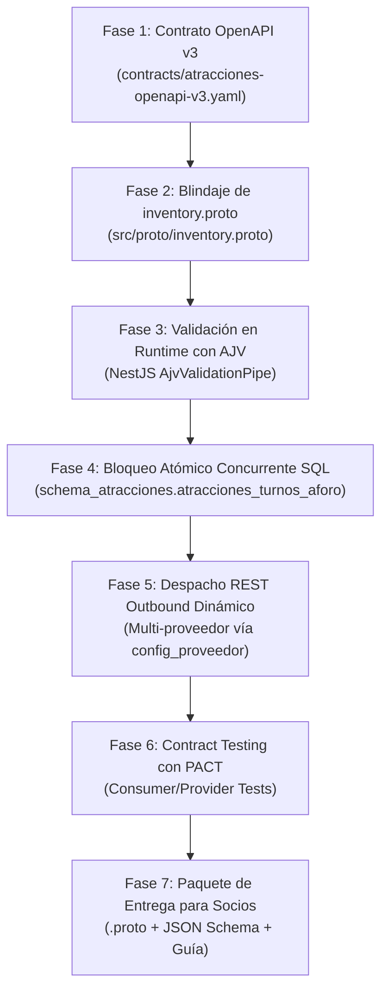

# Plan Maestro de Implementación — Faltantes Semana 9 & Contrato OpenAPI v3

> **Proyecto:** Booking Prototipo (Plataforma Central Integradora — RDA2)  
> **Vertical:** Atracciones Turísticas (Integración Multimodal con 5 Tiendas Externas)  
> **Documento Base:** `Faltantes RDA2/docs/Indicaciones semana 9.md`  
> **Contrato Base:** `contracts/atracciones-openapi-v2.yaml`  
> **Nuevo Contrato Canónico:** `contracts/atracciones-openapi-v3.yaml`  
> **Protocolo Binario:** `src/proto/inventory.proto`  
> **Responsable:** Paúl Rosero (Líder Técnico Booking)  
> **Fecha:** Octubre 2026 (Semana 9)

---

## 1. Resumen Ejecutivo y Diagnóstico

A partir de la auditoría técnica de las **Indicaciones de la Semana 9** y los hallazgos reportados por los agentes de las tiendas individuales, se identificaron 6 brechas críticas de integración:

1. **Dualidad de idiomas y duplicidad de atributos:** El contrato v2 exigía mapear campos en español e inglés simultáneamente (`nombre`/`name`, `hora`/`time`, `cleanliness`/`limpieza`), duplicando código y generando rechazos en validadores automáticos.
2. **Redundancia y ambigüedad en el Checkout:** `POST /atracciones/reservas` solicita obligatoriamente `atraccion_id`, `fecha`, `slot_id` y `hora`, sin definir qué ocurre si `slot_id` y `hora` no concuerdan.
3. **Falta de Validación en Runtime con AJV:** NestJS valida con `class-validator`, pero la cátedra exige validar el payload contra el JSON Schema compilado de OpenAPI usando **AJV**.
4. **Falta de Contract Testing con PACT:** No existe la suite de pruebas PACT para validar el contrato entre el Consumidor (Booking) y los Proveedores externos (tiendas de los 5 compañeros).
5. **Concurrencia y Riesgo de Sobreventa (Race Conditions):** La consulta de aforo actual con `READ COMMITTED` y comprobación simple en memoria no tiene bloqueo pesimista/atómico en SQL, arriesgando sobreventa ante alta concurrencia.
6. **Despacho REST Outbound Monolítico:** Booking debe despachar compras vía REST dinámicamente hacia la URL de cualquiera de los 5 compañeros registrados en `schema_proveedores.config_proveedor`.

---

## 2. Fases de Implementación en Orden Secuencial



---

## FASE 1: Creación del Contrato OpenAPI v3 (`contracts/atracciones-openapi-v3.yaml`)

### 1.1. Objetivo
Crear una nueva especificación OpenAPI 3.0.3 (`atracciones-openapi-v3.yaml`) que resuelva todas las ambigüedades técnicas y adopte el estándar unificado en **inglés**.

### 1.2. Decisiones de Diseño y Correcciones Clave
1. **Unificación Lingüística 100% en Inglés:**
   - Todos los esquemas declararán sus propiedades obligatorias y canónicas en inglés:
     - `name`, `slug`, `short_description`, `long_description`, `price` (`currency`, `amount`), `duration`, `city`, `country`.
     - `includes_food`, `includes_transport`, `includes_guide`.
     - `adult_count`, `child_count`, `senior_count`, `infant_count`.
     - `customer_name`, `customer_email`, `customer_phone`, `document_id`.
     - `time_slot`, `date`, `slot_id`.
   - Los campos en español se retirarán de la lista de `required` del schema estricto (se conservan como alias opcionales en el código backend para retrocompatibilidad tolerante).

2. **Resolución de la Ambigüedad en Checkout (`slot_id` vs `time`):**
   - El contrato v3 formalizará la **Regla de Integridad de Franja**:
     * `slot_id` (ej. `slot-20261025-1030`) es la **clave primaria de aforo** para el bloqueo transaccional.
     * Los campos `date` y `time` deben ser concordantes con dicho `slot_id`.
     * **Comportamiento explícito:** Si el integrador envía un `slot_id` cuyas franjas difieren de `date` o `time`, el servidor retorna **`400 Bad Request`** con Problem Details RFC 7807:
       ```json
       {
         "type": "https://booking.epn.edu.ec/errors/slot-mismatch",
         "title": "Inconsistencia de Franja Horaria",
         "status": 400,
         "detail": "El slot_id 'slot-20261025-1030' corresponde a las 10:30:00 del 2026-10-25, pero se envió 'time': '14:00:00'.",
         "code": "SLOT_TIME_MISMATCH"
       }
       ```

3. **Definición Rigurosa de Códigos de Error para Sagas:**
   - **`400 Bad Request`:** Error sintáctico o inconsistencia (`SLOT_TIME_MISMATCH`, JSON malformado).
   - **`422 Unprocessable Entity`:** Validación semántica estática previa (fecha en el pasado, `adult_count < 1`). **No detona compensación Saga**.
   - **`409 Conflict` (`code: OUT_OF_STOCK`):** Conflicto concurrente de aforo agotado. **Único detonador oficial para compensación LIFO en la Saga**.

4. **Estandarización de URLs y Servidores:**
   - URL canónica: `/api/v3`
   - Servidor Producción (Render): `https://rda1-backend-integracion-sistemas.onrender.com/api/v3`
   - Servidor Local: `http://localhost:3000/api/v3`
   - Servidor Fallback v2: `/api/v2`

---

## FASE 2: Blindaje y Enriquecimiento de `src/proto/inventory.proto`

### 2.1. Objetivo
Actualizar el contrato Protocol Buffers binario para responder a todas las dudas planteadas por los agentes de los compañeros.

### 2.2. Mejoras a incorporar en `inventory.proto`:
1. **Inclusión de `slot_id`:** Añadir el campo `string slot_id = 7;` en `StockUpdateMessage` y `StockChangeEvent` para que exista paridad 1:1 entre el turno gRPC y el turno REST.
2. **Protección contra Eventos Desordenados (Monotonic Timestamp):**
   - Incorporar validación de secuencia por Epoch timestamp (`int64 timestamp`). Si llega un paquete con timestamp inferior al último procesado para ese slot, Booking retorna `success: false` con código `STALE_EVENT_IGNORED`.
3. **Respuesta Enriquecida en `StockUpdateAck`:**
   ```protobuf
   message StockUpdateAck {
     bool success = 1;
     string message = 2;
     int64 processed_at = 3;
     string error_code = 4;        // "OK", "UNKNOWN_SERVICE_ID", "ITEM_NOT_FOUND", "STALE_TIMESTAMP"
     int32 current_available = 5;  // Cupos vigentes confirmados tras la actualización
   }
   ```
4. **RPC de Consulta de Estado:**
   - Agregar `rpc GetSlotAvailability (SlotAvailabilityRequest) returns (SlotAvailabilityResponse);` para permitir a las tiendas validar si Booking está sincronizado antes de abrir ventas.

---

## FASE 3: Validación en Tiempo de Ejecución con AJV (NestJS)

### 3.1. Objetivo
Cumplir el requerimiento explícito: *"Hay que hacer una validación en tiempo real con AJV(NestJS) de los contratos"*.

### 3.2. Pasos de Implementación:
1. **Instalación de dependencias:**
   ```bash
   npm install ajv ajv-formats
   ```
2. **Compilador de Schema:**
   - Generar un script o módulo que compile `atracciones-openapi-v3.yaml` hacia JSON Schema estándar (`src/core/validation/schemas/atracciones.schema.json`).
3. **Implementación de `AjvValidationPipe`:**
   - Crear un Pipe global/modular en NestJS (`src/core/validation/ajv-validation.pipe.ts`).
   - El Pipe intercepta los bodies de `POST /atracciones/reservas`, `POST /atracciones/search`, etc.
   - Ejecuta `ajv.validate(schemaKey, req.body)`.
   - Si la validación falla, formatea los errores de AJV (ej. `params.missingProperty`) y lanza un `HttpException` con formato RFC 7807 (`status: 400`, `title: "Contract Schema Validation Failed"`).

---

## FASE 4: Bloqueo Atómico Concurrente SQL Anti-Sobreventa

### 4.1. Objetivo
Eliminar la condición de carrera entre las actualizaciones gRPC y las compras REST, garantizando aislamiento ACID.

### 4.2. Pasos de Implementación:
1. En `AtraccionesService.reservar()`:
   - Reemplazar la comprobación en memoria por una transacción con **consulta atómica `UPDATE ... RETURNING`**:
     ```sql
     UPDATE schema_atracciones.atracciones_turnos_aforo
     SET cupos_disponibles = cupos_disponibles - $totalTickets,
         estado = CASE 
           WHEN (cupos_disponibles - $totalTickets) <= 0 THEN 'AGOTADO'
           WHEN (cupos_disponibles - $totalTickets) <= 5 THEN 'ULTIMOS_CUPOS'
           ELSE 'DISPONIBLE'
         END
     WHERE (atraccion_id = $id OR turno_id = $slotId)
       AND fecha = $tourDate
       AND hora_inicio = $tourTime
       AND cupos_disponibles >= $totalTickets
     RETURNING cupos_disponibles, estado;
     ```
2. **Control de Conflicto:**
   - Si la consulta retorna `affected === 0` o `rowCount === 0`:
     - Lanzar inmediatamente `409 Conflict` con Problem Details:
       `code: "OUT_OF_STOCK"`, activando la Saga de compensación en el orquestador.

---

## FASE 5: Despacho REST Outbound Dinámico Multi-Proveedor (ESB)

### 5.1. Objetivo
Desacoplar a Booking de un único proveedor hardcodeado y enviar las órdenes REST al compañero dueño de la atracción.

### 5.2. Pasos de Implementación:
1. Al crear la reserva en Booking, obtener el `proveedor_codigo` de la atracción (ej. `NODE_ATR_CRUCEROS_01`).
2. Consultar `schema_proveedores.config_proveedor` para obtener su `baseUrlRest`.
3. Si el Kill-Switch de ese proveedor está activo, rechazar con `503 Service Unavailable / Circuit Breaker OPEN`.
4. Si está activo, enviar `POST ${baseUrlRest}/reservas` mediante `HttpService` con timeout de 5 segundos, cabecera `Idempotency-Key` y `X-Correlation-Id`.
5. Recibir el `201 Created` del compañero con su `external_order_id` o el `409 Conflict` si se agotó en su sistema.

---

## FASE 6: Contract Testing con PACT (Consumer-Driven Contracts)

### 6.1. Objetivo
Cumplir el requerimiento: *"Se debe probar el contrato completo con CONTRACT TESTING (PACT) para comparar el contrato con el schema"*.

### 6.2. Pasos de Implementación:
1. **Instalación de PACT:**
   ```bash
   npm install --save-dev @pact-foundation/pact
   ```
2. **Definición de Pruebas de Consumidor (Booking como Consumer):**
   - Crear archivo de prueba: `test/contracts/atracciones-consumer.pact.spec.ts`.
   - Definir interacciones esperadas:
     * `GET /atracciones/{id}/disponibilidad` ➔ Retorna 200 con array de `time_slots`.
     * `POST /atracciones/reservas` con aforo ➔ Retorna 201 Created con `reservation_code`.
     * `POST /atracciones/reservas` sin aforo ➔ Retorna 409 Conflict con `OUT_OF_STOCK`.
3. **Generación del archivo Pact:**
   - Ejecutar suite Jest para compilar `pacts/BookingConsumer-AtraccionesProvider.json`.
4. **Verificación contra el Schema:**
   - Comparar el archivo Pact generado contra el schema OpenAPI v3 para certificar cumplimiento de cátedra.

---

## FASE 7: Paquete de Entrega y Documentación para los 5 Compañeros

### 7.1. Objetivo
Proveer a los 5 compañeros los insumos formales exactos para que sus agentes implementen la integración sin ambigüedades.

### 7.2. Contenido del Paquete de Integración:
1. `contracts/atracciones-openapi-v3.yaml` (Contrato REST unificado en inglés).
2. `src/proto/inventory.proto` (Contrato gRPC Inbound con `slot_id` y timestamp).
3. `contracts/schemas/atracciones.schema.json` (JSON Schema exportado).
4. `docs/GUIA_INTEGRACION_SOCIOS_ATRACCIONES.md`:
   - Instrucciones claras:
     * Cómo enviar stock por gRPC al puerto 50051 (`PushStockUpdate`).
     * Cómo exponer su endpoint REST `GET /atracciones` para la sincronización de catálogo.
     * Cómo recibir y responder a `POST /reservas` desde Booking (201 vs 409).
     * Regla estricta del checkout (`slot_id` manda; mismatch es 400).

---

## 3. Matriz de Entregables y Verificación

| Entregable | Ruta de Archivo | Criterio de Aceptación |
|---|---|---|
| **Contrato v3** | `contracts/atracciones-openapi-v3.yaml` | 100% inglés, sin campos duplicados, códigos 400/409/422 formales. |
| **Proto Blindado** | `src/proto/inventory.proto` | Soporta `slot_id`, timestamp de secuencia y Ack detallado. |
| **Validador AJV** | `src/core/validation/ajv-validation.pipe.ts` | Valida requests contra JSON Schema en tiempo de ejecución. |
| **Bloqueo Concurrente** | `src/modules/atracciones/atracciones.service.ts` | `UPDATE ... RETURNING` atómico en PostgreSQL sin race conditions. |
| **Router Multi-Socio** | `src/modules/atracciones/atracciones.service.ts` | Despacho REST dinámico leyendo `schema_proveedores.config_proveedor`. |
| **Tests PACT** | `test/contracts/atracciones-consumer.pact.spec.ts` | Test de contrato consumidor/proveedor pasando con Jest. |
| **Guía de Socios** | `Faltantes RDA2/docs/GUIA_INTEGRACION_SOCIOS.md` | Documento listo para entregar a los 5 compañeros. |
