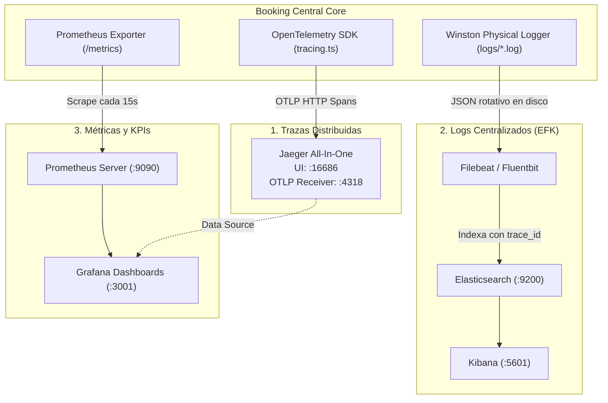

# Plan Maestro de Implementación: Observabilidad, Trazabilidad y SRE (RDA3)

> **Asignatura:** Integración de Sistemas — 6to Semestre  
> **Sistema:** Booking Central (Plataforma B2B Multivertical)  
> **Referencia Académica:** Semana 10 — *Observabilidad y trazas distribuidas* (Damián Nicolalde, PUCE)  
> **Ubicación:** `RDA3/Indicaciones/PLAN_IMPLEMENTACION_OBSERVABILIDAD_RDA3.md`  
> **Estado:** Documento Maestro y Guía de Implementación Técnica  

---

## 1. Justificación y Fundamento Teórico (Semana 10)

En sistemas distribuidos basados en microservicios, eventos y socios B2B externos, la observabilidad no es simplemente "guardar logs", sino la capacidad de inferir el estado interno de la plataforma a partir de sus salidas públicas.

### 1.1. Los Tres Pilares Clásicos
Siguiendo la sección 10.1 del libro de cátedra:
- **Trazas (Jaeger):** Responden a la pregunta *¿Por dónde pasó exactamente esta solicitud y cuánto tardó en cada paso?* Permite identificar el camino crítico y el cuello de botella.
- **Logs (EFK - Elasticsearch, Fluentbit, Kibana / Winston):** Responden a la pregunta *¿Qué pasó exactamente, en detalle y con qué payload en este instante?* Provee el contexto textual exhaustivo.
- **Métricas (Prometheus + Grafana):** Responden a la pregunta *¿Cómo se comporta el sistema en su conjunto y cómo evoluciona en el tiempo?* Alimenta las alertas tempranas y los tableros ejecutivos.

### 1.2. La Insuficiencia de la Auto-Instrumentación
La auto-instrumentación de OpenTelemetry captura automáticamente las fronteras técnicas (peticiones HTTP entrantes y consultas SQL a la base de datos). Sin embargo, ve toda la lógica de negocio interna como un **único span HTTP plano e indiferenciado** (ej. "el endpoint tardó 1200 ms").
Sin **instrumentación manual**, es imposible saber en Jaeger si el tiempo se perdió:
1. Validando aforos o ventanas de cancelación en memoria local.
2. Esperando la respuesta HTTP del socio externo (Gloria, Dilan, Michael).
3. Escribiendo el diario transaccional de la Saga en PostgreSQL.
4. Encolando el evento en RabbitMQ.

---

## 2. Spans Manuales y Atributos Semánticos de Negocio

### 2.1. Anatomía de la Traza Transaccional (Diagrama de Gantt en Jaeger)
Para el flujo crítico de reserva y checkout multivertical (`POST /api/v1/atracciones/reservas` o `POST /api/v1/esb/checkout-saga`), el span HTTP principal de entrada (`SpanKind.SERVER`) se descompone en **5 spans manuales hijos**:

```mermaid
gantt
    title Anatomía de la Traza Distribuida en Jaeger (Flujo de Reserva B2B)
    dateFormat X
    axisFormat %s ms
    section Span HTTP Raíz
    SERVER: POST /api/v1/atracciones/reservas :0, 1100
    section Spans Manuales Hijos
    1. validar_reglas_negocio_aforo (INTERNAL) :active, 0, 120
    2. acl_transformacion_dto (INTERNAL) :120, 180
    3. invocacion_socio_b2b (CLIENT) [Circuit Breaker 5s] :180, 820
    4. saga_transaccion_journal (INTERNAL) [PostgreSQL Outbox] :820, 960
    5. broker_publicar_evento (PRODUCER) [RabbitMQ Topic] :960, 1080
    section Fallo / Rollback
    saga_compensacion_lifo (INTERNAL) [Si socio da 409/504] :820, 1050
```

### 2.2. Definición Detallada de cada Span Manual

1. **`validar_reglas_negocio_aforo`** (`SpanKind.INTERNAL`):
   - **Propósito:** Validar en memoria la clave de idempotencia (`Idempotency-Key`), rango horario, formato de pasajeros y la regla obligatoria de no cancelación a menos de 24 horas.
2. **`acl_transformacion_dto`** (`SpanKind.INTERNAL`):
   - **Propósito:** Mapear el modelo de datos canónico de Booking Central hacia el formato heterogéneo requerido por el socio (`DilanAtraccionesAdapter`, `AutosCircuitBreakerAdapter`, etc.).
3. **`invocacion_socio_b2b`** (`SpanKind.CLIENT`):
   - **Propósito:** Medir con exactitud milimétrica el viaje de ida y vuelta hacia la API externa del compañero bajo la protección del Circuit Breaker (timeout 5000 ms).
   - *Importancia para la defensa:* Si el trace dura 2.3s y este span ocupa 2.1s, queda demostrado técnicamente al evaluador que la demora radica en la infraestructura del socio federado y no en Booking Central.
4. **`saga_transaccion_journal`** (`SpanKind.INTERNAL`):
   - **Propósito:** Registrar el paso transaccional en `schema_auditoria.saga_transacciones` e insertar el evento en la tabla `outbox`.
5. **`broker_publicar_evento`** (`SpanKind.PRODUCER`):
   - **Propósito:** Inyectar el mensaje transaccional (`order.confirmed` o `stock.updated`) en el Exchange Topic de RabbitMQ, propagando el header W3C `traceparent`.
6. **`saga_compensacion_lifo`** (`SpanKind.INTERNAL`):
   - **Propósito:** Ejecutar la restitución inmediata de aforos y disparar la reversión de fondos si el socio externo respondió con `HTTP 409 Conflict` o `504 Timeout`.

### 2.3. Convenciones Semánticas de Atributos OpenTelemetry

| Span Manual | Atributos Semánticos Obligatorios | Ejemplo Real de Valor |
| :--- | :--- | :--- |
| **Transversales** | `booking.correlation_id`<br>`booking.tenant_id`<br>`booking.vertical`<br>`service.name` | `"corr-uuid-7712"`<br>`"turista_usr_44"`<br>`"atracciones"`<br>`"booking-core-backend"` |
| **`validar_reglas_negocio_aforo`** | `business.rule.name`<br>`booking.idempotency_key`<br>`booking.ticket_count` | `"politica_cancelacion_24h"`<br>`"idem-uuid-99"`<br>`3` |
| **`acl_transformacion_dto`** | `acl.adapter_class`<br>`acl.source_schema`<br>`acl.target_schema` | `"DilanAtraccionesAdapter"`<br>`"BookingCanonicalDTO"`<br>`"DescubreEC_v3"` |
| **`invocacion_socio_b2b`** | `peer.service`<br>`http.method`<br>`http.url`<br>`http.status_code`<br>`circuit_breaker.state`<br>`error.type` (en caso de fallo) | `"ViveloEcuador_Gloria"`<br>`"POST"`<br>`"https://ms-catalog.../reservar"`<br>`200` (o `409`)<br>`"CLOSED"`<br>`"OUT_OF_STOCK"` |
| **`saga_transaccion_journal`** | `saga.id`<br>`saga.step`<br>`db.system`<br>`db.operation` | `"saga-tx-1029"`<br>`"CONFIRMAR_ASIENTO"`<br>`"postgresql"`<br>`"INSERT / UPDATE"` |
| **`broker_publicar_evento`** | `messaging.system`<br>`messaging.destination`<br>`messaging.destination_kind`<br>`messaging.rabbitmq.routing_key` | `"rabbitmq"`<br>`"booking.events"`<br>`"topic"`<br>`"order.confirmed"` |
| **`saga_compensacion_lifo`** | `saga.status`<br>`saga.failed_provider`<br>`saga.compensation_step` | `"COMPENSATING"`<br>`"TourGirls_Michael"`<br>`"REVERTIR_AFORO_LOCAL"` |

---

## 3. Arquitectura del Stack de Observabilidad

Para cumplir con el requerimiento de los 3 pilares unificados, se despliega un stack contenerizado:



### 3.1. Especificación de Contenedores (`docker-compose.observability.yml`)
```yaml
version: '3.8'
services:
  jaeger:
    image: jaegertracing/all-in-one:latest
    container_name: booking_jaeger
    ports:
      - "16686:16686" # Web UI
      - "4318:4318"   # Receptor OTLP HTTP
    environment:
      - COLLECTOR_OTLP_ENABLED=true

  prometheus:
    image: prom/prometheus:latest
    container_name: booking_prometheus
    ports:
      - "9090:9090"
    volumes:
      - ./deploy/prometheus.yml:/etc/prometheus/prometheus.yml

  grafana:
    image: grafana/grafana:latest
    container_name: booking_grafana
    ports:
      - "3001:3000"
    environment:
      - GF_SECURITY_ADMIN_PASSWORD=admin
    depends_on:
      - prometheus
      - jaeger

  elasticsearch:
    image: docker.elastic.co/elasticsearch/elasticsearch:8.11.0
    container_name: booking_elasticsearch
    environment:
      - discovery.type=single-node
      - xpack.security.enabled=false
      - "ES_JAVA_OPTS=-Xms512m -Xmx512m"
    ports:
      - "9200:9200"

  kibana:
    image: docker.elastic.co/kibana/kibana:8.11.0
    container_name: booking_kibana
    ports:
      - "5601:5601"
    environment:
      - ELASTICSEARCH_HOSTS=http://elasticsearch:9200
    depends_on:
      - elasticsearch
```

---

## 4. Implementación en Código de la Trazabilidad

### 4.1. Inicialización de OpenTelemetry (`src/tracing.ts`)
> [!IMPORTANT]
> Siguiendo la regla de oro de la Semana 10 (pág. 11), `tracing.ts` **debe importarse en la primera línea de `src/main.ts`**, antes que cualquier módulo de NestJS, para permitir la inyección de los parches de auto-instrumentación en Node.js.

```typescript
// src/tracing.ts
import { NodeSDK } from '@opentelemetry/sdk-node';
import { getNodeAutoInstrumentations } from '@opentelemetry/auto-instrumentations-node';
import { OTLPTraceExporter } from '@opentelemetry/exporter-trace-otlp-http';
import { resourceFromAttributes } from '@opentelemetry/resources';

export const otelSdk = new NodeSDK({
  resource: resourceFromAttributes({
    'service.name': process.env.OTEL_SERVICE_NAME || 'booking-core-backend',
    'deployment.environment': process.env.NODE_ENV || 'development',
  }),
  traceExporter: new OTLPTraceExporter({
    url: process.env.OTEL_EXPORTER_OTLP_ENDPOINT || 'http://localhost:4318/v1/traces',
  }),
  instrumentations: [
    getNodeAutoInstrumentations({
      '@opentelemetry/instrumentation-fs': { enabled: false }, // Desactivar ruido de disco
    }),
  ],
});

otelSdk.start();
```

### 4.2. Propagación de Contexto W3C en RabbitMQ (Semana 10, pág. 10 y 28)
Para evitar que el trace se corte en el broker de mensajería:

```typescript
// 1. En el Publicador (RabbitMqEventBusService):
const traceparent = this.traceContext.traceparent(); // ej. '00-4bf92f...-01'
await this.channel.publish(this.EXCHANGE_NAME, routingKey, Buffer.from(JSON.stringify(payload)), {
  persistent: true,
  headers: {
    traceparent: traceparent,
    correlation_id: correlationId,
  },
});

// 2. En el Consumidor (RabbitMqConsumerService):
const rawTraceparent = msg.properties.headers?.traceparent;
const context = this.traceContext.createContext(msg.properties.headers?.correlation_id, rawTraceparent);
this.traceContext.run(context, async () => {
  await this.procesarMensaje(payload);
});
```

---

## 5. Marco SRE: SLIs, SLOs y Error Budget

Siguiendo la sección 10.4 del libro de cátedra (págs. 16–19), se define el compromiso de calidad para Booking Central:

### 5.1. Definición de SLIs y SLOs por Nivel de Criticidad

```
+---------------------------------------------------------------------------------------------------------+
|                                    SLIs Y SLOs DE BOOKING CENTRAL                                       |
+---------------------+---------------------------------------+---------------------+---------------------+
| SERVICIO / FLUJO    | INDICADOR (SLI)                       | OBJETIVO (SLO)      | ERROR BUDGET (30D)  |
+---------------------+---------------------------------------+---------------------+---------------------+
| 1. Reservas & Sagas | Disponibilidad: Reservas exitosas o   | >= 99.0% en 30 días | 1.0% de fallos      |
|    (Crítico)        | compensadas limpiamente / Total       |                     | (100 de 10,000 tx)  |
+---------------------+---------------------------------------+---------------------+---------------------+
| 2. Latencia Reserva | Latencia: Percentil 95 (p95) del span | >= 95.0% en < 2.5s  | 5.0% de reservas    |
|    (Crítico)        | raíz del trace de checkout            |                     | lentas (> 2.5s)     |
+---------------------+---------------------------------------+---------------------+---------------------+
| 3. Catálogo Público | Disponibilidad: Consultas exitosas    | >= 99.5% en 30 días | 0.5% de fallos      |
|    (Alta Carga)     | sin HTTP 500 / Total búsquedas        |                     |                     |
+---------------------+---------------------------------------+---------------------+---------------------+
| 4. Latencia Búsqueda| Latencia: p95 de consulta catálogo    | >= 95.0% en < 400ms | 5.0% búsquedas      |
|    (Alta Carga)     | (apoyado en Redis/RAM)                |                     | lentas (> 400ms)    |
+---------------------+---------------------------------------+---------------------+---------------------+
```

### 5.2. Alertas Basadas en Tasa de Consumo (Burn Rate) y Consecuencia de Negocio

El libro (pág. 17) establece que no se debe esperar al 100% de agotamiento para actuar:

- **Burn Rate 1x (Normal):** Consumo al ritmo presupuestado (~30 días). Operación habitual.
- **Burn Rate 6x (Alerta Media):** El presupuesto se agotará en 5 días. Notificación por canal de integración.
- **Burn Rate 14.4x (Alerta Severa):** El presupuesto se agotará en 2 días. Suspensión de despliegues no críticos.
- **Burn Rate 36x (Incidente Crítico):** Se agotará en 20 horas. Activación inmediata de *kill-switches* y aislamiento del socio causante.

> [!CAUTION]
> **Política de Feature Freeze (Semana 10, pág. 19):**  
> Si a mitad de mes se ha consumido más del **80% del Error Budget de reservas**, se congelan temporalmente nuevos despliegues o cambios de esquema. El 100% del esfuerzo técnico se reorienta a optimizar la resiliencia y estabilidad de las integraciones.

---

## 6. Dashboards Obligatorios de Producción (Grafana y Frontend)

Para la monitorización de producción y defensa ante el docente se establecen 4 tableros:

1. **Dashboard 1: Visión Ejecutiva SRE & SLOs (Grafana / Frontend):**
   - Tarjeta SLI de Disponibilidad (ej. `99.3%` en verde).
   - Medidor de Error Budget Consumido (`22% consumido / 78% disponible`).
   - Latencia p95 actual vs. línea de SLO de 2.5s.
   - Índice Apdex de satisfacción del turista (ej. `0.94 - Satisfactorio`).
2. **Dashboard 2: Salud del Ecosistema B2B (Frontera Externa):**
   - Semáforo de Socios (Gloria, Dilan, Michael, Ariel, Alisson, Autos, Alojamientos).
   - Gráfico de barras comparativo de latencia por proveedor.
   - Historial de conmutaciones de Circuit Breaker (`CLOSED` -> `OPEN`).
3. **Dashboard 3: Orquestación Transaccional y Sagas (ESB y Eventos):**
   - Tasa de Sagas completadas vs. compensadas (Rollbacks LIFO).
   - Profundidad de colas en RabbitMQ (`q.busquedas.masivas`, `q.ordenes.confirmadas`).
   - Contador de alerta de Dead Letter Queue (`q.dead_letter`).
4. **Dashboard 4: Service Mesh e Infraestructura Interna:**
   - Matriz de latencias Este-Oeste (`MS_CORE`, `MS_ESB`, `MS_PAG`, `MS_FAC`).
   - Conexiones activas en PostgreSQL por esquema.
   - Throughput de inventario gRPC sobre el puerto TCP 50051.

---

## 7. Plan de Acción y Hoja de Ruta de Implementación

| Paso | Tarea Técnica | Archivos Involucrados | Criterio de Aceptación |
| :---: | :--- | :--- | :--- |
| **1** | Instalar paquetes OpenTelemetry | `package.json` | Paquetes `@opentelemetry/*` instalados sin romper dependencias. |
| **2** | Crear SDK de inicialización OTel | [`src/tracing.ts`](file:///src/tracing.ts)<br>[`src/main.ts`](file:///src/main.ts) | Importado en línea 1 de `main.ts`. Exporta trazas hacia Jaeger `:4318`. |
| **3** | Levantar Jaeger y Prometheus | `docker-compose.observability.yml` | Jaeger UI visible en `:16686` y Prometheus en `:9090`. |
| **4** | Instrumentar Spans Manuales | [`atracciones.service.ts`](file:///src/modules/atracciones/atracciones.service.ts)<br>[`saga-orchestrator.service.ts`](file:///src/modules/esb/interna/saga-orchestrator.service.ts) | Traza visible en Jaeger con los 5 spans hijos en diagrama de Gantt. |
| **5** | Propagación W3C en RabbitMQ | [`rabbitmq-event-bus.service.ts`](file:///src/modules/event-bus/rabbitmq/rabbitmq-event-bus.service.ts)<br>[`rabbitmq-consumer.service.ts`](file:///src/modules/event-bus/consumer/rabbitmq-consumer.service.ts) | Mismo `trace_id` en peticiones HTTP y eventos consumidos. |
| **6** | Cálculo y Visualización de SLOs | [`AdminDashboard.jsx`](file:///frontend/src/pages/AdminDashboard.jsx)<br>[`observabilidad.controller.ts`](file:///src/modules/observabilidad/observabilidad.controller.ts) | Panel en frontend mostrando semáforo SLI y barra de Error Budget. |

---

## 8. Guía para la Demostración en la Defensa (Flujo de Causa Raíz)

Ante una pregunta del docente sobre cómo se usa este stack para resolver un incidente en vivo:
1. **Paso 1 (Métrica):** Mostrar en Grafana o Admin Dashboard que la latencia p95 superó el umbral del SLO a las 11:30 a.m. y consumió el 12% del Error Budget.
2. **Paso 2 (Traza):** Abrir Jaeger (`:16686`), filtrar por la ventana horaria y seleccionar el trace con mayor duración. Señalar al docente que el span manual `invocacion_socio_b2b` concentra el 92% de la barra temporal.
3. **Paso 3 (Log):** Copiar el `trace_id` de Jaeger y buscarlo en `logs/audit.log` o Kibana. Mostrar el mensaje exacto de timeout o error emitido por la API externa.
4. **Conclusión Técnica:** Demostrar con evidencia cuantitativa que la plataforma Booking Central gestionó el fallo con resiliencia, aisló el socio con Circuit Breaker y ejecutó la Saga compensatoria sin pérdida de datos.
