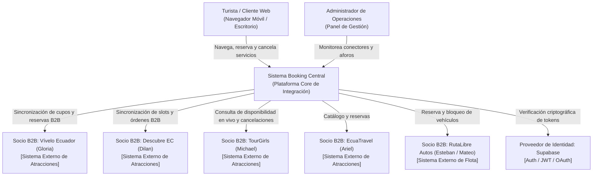

# Booking Central - Plataforma de Integración Turística B2B

> **Proyecto de Integración de Sistemas (RDA2)**  
> Plataforma de comercio electrónico y orquestación distribuida para la reserva federada de servicios turísticos: **Atracciones, Autos, Alojamientos y Vuelos**.

---

## Tabla de Contenidos
1. [Visión General del Sistema](#1-visión-general-del-sistema)
2. [Diagrama de la Arquitectura por Capas](#2-diagrama-de-la-arquitectura-por-capas)
3. [Estilos Arquitectónicos](#3-estilos-arquitectónicos)
4. [Patrones Arquitectónicos de Integración (EIP)](#4-patrones-arquitectónicos-de-integración-eip)
5. [Componentes Arquitectónicos](#5-componentes-arquitectónicos)
6. [Vistas Arquitectónicas (Modelo C4 y 4+1)](#6-vistas-arquitectónicas-modelo-c4-y-41)
7. [Atributos de Calidad y Requerimientos No Funcionales (RNF)](#7-atributos-de-calidad-y-requerimientos-no-funcionales-rnf)
8. [Registro de Decisiones de Arquitectura (ADRs)](#8-registro-de-decisiones-de-arquitectura-adrs)
9. [Guía de Despliegue y Ejecución Local](#9-guía-de-despliegue-y-ejecución-local)

---

## 1. Visión General del Sistema

**Booking Central** es un ecosistema distribuido federado diseñado bajo los principios de **Domain-Driven Design (DDD)** y arquitectura de **Integración Empresarial (EAI / B2B)**. Opera como un concentrador de servicios que conecta a usuarios finales (turistas) con plataformas externas e independientes desarrolladas por socios comerciales:

- **Atracciones**: Integración B2B con *Descubre EC* (Dilan), *Vívelo Ecuador* (Gloria), *TourGirls* (Michael), *EcuaTravel* (Ariel) y *Atracciones Ecuador* (Alisson).
- **Autos**: Integración con flotas federadas (*RutaLibre Autos*, *AutoSpot*, *DriveEC*).
- **Alojamientos**: Integración con cadenas hoteleras y motores de reserva asociados.
- **Vuelos**: Integración de itinerarios aéreos nacionales e internacionales con emisión de pases de abordar.

El núcleo central proporciona agregación de catálogos en tiempo real, orquestación de transacciones distribuidas (Sagas), tolerancia a fallos mediante Circuit Breakers, trazabilidad transversal distribuida y gobernanza de contratos OpenAPI v2 y v3.

---

## 2. Diagrama de la Arquitectura por Capas (RDA2 Producción)

El siguiente diagrama formaliza la arquitectura distribuida del ecosistema **Booking Central (RDA2)** bajo el principio de 7 capas desacopladas, persistencia independiente (*Database-per-Service* en 12 esquemas herméticos), Enterprise Service Bus (ESB) centralizado de dos capas, doble broker de eventos (RabbitMQ + Apache Kafka) y observabilidad física rotativa:

```mermaid
graph LR
    %% =========================================================================
    %% CAPA 1: PERSISTENCIA INDEPENDIENTE POSTGRESQL / SUPABASE (12 ESQUEMAS)
    %% =========================================================================
    subgraph CAPA1 ["CAPA 1: PERSISTENCIA INDEPENDIENTE POSTGRESQL (12 ESQUEMAS)"]
        subgraph SCH_CLI ["schema_clientes"]
            T_CLI[("clientes / identidades")]
        end

        subgraph SCH_CAR ["schema_carritos"]
            T_CAR[("carritos")]
            T_CIT[("carrito_items")]
        end

        subgraph SCH_FAC ["schema_facturacion"]
            T_FEN[("facturas_encabezado")]
            T_FDE[("facturas_detalle")]
        end

        subgraph SCH_PAG ["schema_pagos"]
            T_PAG[("transacciones_pago")]
        end

        subgraph SCH_PKG ["schema_paquetes"]
            T_PKG[("paquetes")]
            T_PIT[("paquete_items")]
            T_CPR[("contrato_promociones")]
        end

        subgraph SCH_FIN ["schema_finanzas"]
            T_FIN[("liquidaciones_proveedores")]
        end

        subgraph SCH_PROV ["schema_proveedores"]
            T_PROV[("config_proveedor / nodos")]
        end

        subgraph SCH_ATR ["schema_atracciones"]
            T_ATR_C[("atracciones_cache")]
            T_ATR_R[("categorias_recursivas")]
            T_ATR_O[("reservas_atraccion")]
            T_ATR_S[("resenas_atraccion")]
        end

        subgraph SCH_AUT ["schema_autos"]
            T_AUT_C[("autos_cache")]
            T_AUT_O[("reservas_auto")]
            T_AUT_M[("mantenimiento_autos")]
        end

        subgraph SCH_ALO ["schema_alojamientos"]
            T_ALO_C[("alojamientos_cache")]
            T_ALO_H[("tipos_habitacion")]
            T_ALO_O[("reservas_alojamiento")]
            T_ALO_U[("huespedes_reserva")]
        end

        subgraph SCH_VUE ["schema_vuelos"]
            T_VUE_C[("vuelos_cache")]
            T_VUE_O[("reservas_vuelo")]
            T_VUE_A[("asientos_vuelo")]
            T_VUE_P[("pases_abordar")]
        end

        subgraph SCH_AUD ["schema_auditoria"]
            T_AUD_TRX[("auditoria_transacciones")]
            T_AUD_ADM[("auditoria_administrativa")]
            T_AUD_SAG[("auditoria_sagas")]
        end
    end

    %% =========================================================================
    %% CAPA 2: MICROSERVICIOS BÁSICOS (12 REST TYPEORM + 1 gRPC EN PUERTO 50051)
    %% =========================================================================
    subgraph CAPA2 ["CAPA 2: MICROSERVICIOS BÁSICOS (12 REST + 1 gRPC 50051)"]
        MS_CLI["MS Clientes y Auth\n(REST / TypeORM)"]
        MS_CAR["MS Carrito y Checkout\n(REST / TypeORM)"]
        MS_FAC["MS Facturación\n(REST / TypeORM / Idempotency)"]
        MS_PAG["MS Simulación Pagos\n(REST / TypeORM / Idempotency)"]
        MS_PKG["MS Paquetes Dinámicos\n(REST / TypeORM)"]
        MS_FIN["MS Finanzas y Liquidaciones\n(REST / TypeORM)"]
        MS_PROV["MS Proveedores y Salud Nodos\n(REST / TypeORM / Kill-Switches)"]
        MS_AUD["MS Auditoría Transaccional\n(REST / TypeORM / SQL)"]

        MS_ATR["MS Atracciones\n(REST / TypeORM / Árbol Recursivo)"]
        MS_AUT["MS Autos y Flota\n(REST / TypeORM / Cooldown 2h)"]
        MS_ALO["MS Alojamientos\n(REST / TypeORM / Check-in 48h)"]
        MS_VUE["MS Vuelos\n(REST / TypeORM / PNR y Pases)"]
        MS_STK["MS Ingesta Stock\n(gRPC Inbound TCP 50051 / Redis)"]
    end

    %% Enlaces Capa 1 a Capa 2
    T_CLI -.-> MS_CLI
    T_CAR -.-> MS_CAR
    T_CIT -.-> MS_CAR
    T_FEN -.-> MS_FAC
    T_FDE -.-> MS_FAC
    T_PAG -.-> MS_PAG
    T_PKG -.-> MS_PKG
    T_PIT -.-> MS_PKG
    T_CPR -.-> MS_PKG
    T_FIN -.-> MS_FIN
    T_PROV -.-> MS_PROV

    T_ATR_C -.-> MS_ATR
    T_ATR_R -.-> MS_ATR
    T_ATR_O -.-> MS_ATR
    T_ATR_S -.-> MS_ATR

    T_AUT_C -.-> MS_AUT
    T_AUT_O -.-> MS_AUT
    T_AUT_M -.-> MS_AUT

    T_ALO_C -.-> MS_ALO
    T_ALO_H -.-> MS_ALO
    T_ALO_O -.-> MS_ALO
    T_ALO_U -.-> MS_ALO

    T_VUE_C -.-> MS_VUE
    T_VUE_O -.-> MS_VUE
    T_VUE_A -.-> MS_VUE
    T_VUE_P -.-> MS_VUE

    T_AUD_TRX -.-> MS_AUD
    T_AUD_ADM -.-> MS_AUD
    T_AUD_SAG -.-> MS_AUD

    %% =========================================================================
    %% CAPA 3: ESB CENTRALIZADO DE DOS CAPAS (ENTERPRISE SERVICE BUS)
    %% =========================================================================
    subgraph CAPA3 ["CAPA 3: ESB CENTRALIZADO DE DOS CAPAS"]
        subgraph ESB_INT ["ESB Capa Interna: Servicios Propios"]
            ESB_ROUTER["Enrutador de Negocio y Sustituto de SQL Joins"]
            ESB_SAGA["Orquestador Saga Compra y Compensación LIFO"]
            ESB_POLICIES["Validación de Reglas de Negocio Internas"]
        end

        subgraph ESB_EXT ["ESB Capa de Integración Externa: Socios B2B"]
            ESB_ACL["Capa Anti-Corrupción (ACL) y Normalización DTO"]
            ESB_CB["Circuit Breakers (Timeout 5s / Fallbacks)"]
            ESB_KILL["Kill-Switches de Aislamiento de Socios"]
        end
    end

    %% =========================================================================
    %% SERVICE MESH Y COMUNICACIÓN INTER-SERVICIO (ESTE-OESTE)
    %% =========================================================================
    subgraph SERVICE_MESH ["SERVICE MESH (GOBERNANZA ESTE-OESTE)"]
        SM_INTERCEPTOR["Sidecar Proxy Interceptor\n(sidecar-proxy.interceptor.ts)"]
        SM_TELEMETRY["Métricas Latencia y Tracing X-Correlation-Id"]
        SM_RATE_LIMIT["Rate Limiting Interno y Protección de Malla"]
        SM_INTERCEPTOR --- SM_TELEMETRY
        SM_TELEMETRY --- SM_RATE_LIMIT
    end

    %% Enlaces Capa 2 a Capa 3
    MS_CLI <--> ESB_ROUTER
    MS_CAR <--> ESB_ROUTER
    MS_FAC <--> ESB_ROUTER
    MS_PAG <--> ESB_ROUTER
    MS_PKG <--> ESB_ROUTER
    MS_FIN <--> ESB_ROUTER
    MS_PROV <--> ESB_ROUTER
    MS_AUD <--> ESB_ROUTER

    MS_ATR <--> ESB_ACL
    MS_AUT <--> ESB_ACL
    MS_ALO <--> ESB_ACL
    MS_VUE <--> ESB_ACL
    MS_STK -->|Stream de Stock Recibido| ESB_ACL

    ESB_ROUTER <--> ESB_SAGA
    ESB_ROUTER <--> ESB_ACL
    ESB_ACL --- ESB_CB
    ESB_CB --- ESB_KILL

    ESB_ROUTER -.->|Intercepción Tráfico Este-Oeste| SM_INTERCEPTOR
    ESB_ACL -.->|Telemetría y Tracing| SM_INTERCEPTOR

    %% =========================================================================
    %% SOCIOS EXTERNOS (COMPAÑEROS B2B)
    %% =========================================================================
    subgraph SOCIOS ["SOCIOS EXTERNOS (COMPAÑEROS B2B RDA2)"]
        EXT_GLORIA["Vívelo Ecuador (Gloria)\n[Azure Container App - ms-catalog]"]
        EXT_DILAN["Descubre EC (Dilan)\n[Azure Container App - descubre-gateway]"]
        EXT_MICHAEL["TourGirls (Michael)\n[Azure Web App - tourgirls-gateway]"]
        EXT_ARIEL["EcuaTravel (Ariel)\n[Azure Web App - ecuatravel-api]"]
        EXT_ALISSON["Atracciones EC (Alisson)\n[Azure Web App - alisson-api]"]
        EXT_AUTOS["RutaLibre Autos (Esteban/Mateo)\n[APIs REST Flota]"]
        EXT_ALOJ["Motores de Alojamiento\n[APIs REST Hoteles]"]
        EXT_VUELOS["Aerolíneas Aliadas\n[APIs REST Vuelos]"]
        EXT_GRPC["Push de Stock en Vivo Socios\n(gRPC Client Streaming)"]
    end

    ESB_ACL <-->|REST B2B: Disponibilidad / Reserva / Cancelación| EXT_GLORIA
    ESB_ACL <-->|REST B2B: Slots / Órdenes / Cancelación| EXT_DILAN
    ESB_ACL <-->|REST B2B: Time Slots / Sincronización Estado| EXT_MICHAEL
    ESB_ACL <-->|REST B2B: Catálogos y Reservas| EXT_ARIEL
    ESB_ACL <-->|REST B2B: Integración Atracciones| EXT_ALISSON
    ESB_ACL <-->|REST B2B: Reserva Vehículos y Cooldown| EXT_AUTOS
    ESB_ACL <-->|REST B2B: Check-in y Habitaciones| EXT_ALOJ
    ESB_ACL <-->|REST B2B: Itinerarios y Pases| EXT_VUELOS
    EXT_GRPC ==>|Inbound TCP Puerto 50051| MS_STK

    %% =========================================================================
    %% CAPA 4: EVENT BUS Y STREAMING (RABBITMQ + APACHE KAFKA DUAL BROKER)
    %% =========================================================================
    subgraph CAPA4 ["CAPA 4: EVENT BUS Y STREAMING DUAL (RABBITMQ + APACHE KAFKA)"]
        subgraph BROKER_RABBIT ["Broker Transaccional: RabbitMQ (AMQP 0-9-1)"]
            RB_EX["Exchange: booking.events (Topic)"]
            Q_SEARCH["Cola: q.busquedas.masivas (Dampening)"]
            Q_BUY["Cola: q.ordenes.confirmadas (Compras y Facturación)"]
            Q_SAGA["Cola: q.sagas.compensacion (Rollbacks LIFO)"]
            Q_STOCK["Cola: q.stock.actualizado (Alta Prioridad RAM)"]
            Q_DLQ["Cola: q.dead_letter (DLQ tras 3 reintentos)"]
        end

        subgraph BROKER_KAFKA ["Event Streaming Commit Log: Apache Kafka Cluster"]
            KF_BRIDGE["Cross-Broker Bridge: Conector RabbitMQ-Kafka"]
            TOPIC_CAT["Tópico: booking.catalogo.stream (Por Vertical)"]
            TOPIC_AUD["Tópico: booking.compras.audit (Por Cliente)"]
            TOPIC_TEL["Tópico: booking.telemetria.nodes (Salud y Latencia)"]
        end
    end

    ESB_ROUTER -->|Publica eventos negocio| RB_EX
    ESB_SAGA -->|Emite orden confirmada o fallo| RB_EX
    MS_STK -->|Emite stock.actualizado directo| RB_EX

    RB_EX --> Q_SEARCH
    RB_EX --> Q_BUY
    RB_EX --> Q_SAGA
    RB_EX --> Q_STOCK
    RB_EX --> Q_DLQ

    RB_EX -.->|Event Sourcing Replay| KF_BRIDGE
    KF_BRIDGE --> TOPIC_CAT
    KF_BRIDGE --> TOPIC_AUD
    KF_BRIDGE --> TOPIC_TEL

    %% =========================================================================
    %% CAPA 5: MICROSERVICIOS ORQUESTADOS (LÓGICA COMPUESTA & SEGURIDAD)
    %% =========================================================================
    subgraph CAPA5 ["CAPA 5: MICROSERVICIOS ORQUESTADOS"]
        ORQ_FAC["ORQ_FAC: Facturación Compuesta (Factura + Cliente + Detalle + IVA 15%)"]
        ORQ_PKG["ORQ_PKG: Motor Paquetes Dinámicos (Validación Combo y Descuentos)"]
        ORQ_STK["ORQ_STK: Orquestador Stock (Consolidación Stock gRPC + Catálogo)"]
        ORQ_RES["ORQ_RES: Orquestador Reservas (Checkout Multivertical y Sagas)"]
        SEC_AUTH["Seguridad Transversal: JWT Guard + RBAC (CLIENTE, ADMIN, MANTENIMIENTO)"]
    end

    ESB_ROUTER --> ORQ_FAC
    ESB_ROUTER --> ORQ_PKG
    ESB_SAGA <--> ORQ_RES
    Q_STOCK --> ORQ_STK
    Q_BUY --> ORQ_FAC
    Q_BUY --> MS_FIN
    Q_SAGA --> ORQ_RES

    TOPIC_AUD -.->|Stream Audit Inmutable| MS_AUD
    TOPIC_TEL -.->|Stream Telemetría| MS_PROV

    ORQ_FAC --- SEC_AUTH
    ORQ_PKG --- SEC_AUTH
    ORQ_STK --- SEC_AUTH
    ORQ_RES --- SEC_AUTH

    %% =========================================================================
    %% CAPA 6: API GATEWAY Y BFF UNIFICADO (GRAPHQL / REVERSE PROXY)
    %% =========================================================================
    subgraph CAPA6 ["CAPA 6: API GATEWAY Y BFF UNIFICADO (GRAPHQL / REVERSE PROXY)"]
        GW_SEC["Gateway Security: JWT Guards + Rate Limiter + Depth Limiting"]
        GQL_SRV["Apollo Server NestJS: Single Entry Point /graphql y /api/v1/*"]
        GQL_LOAD["DataLoaders: Resolución Batch (Anti-N+1 Problem)"]
        GQL_WS["Suscripciones WebSocket (ws://) para Alertas en Vivo"]
        subgraph GQL_OPS ["Operaciones GraphQL Schema"]
            GQL_Q["Queries: catalogoUnificado, misReservas, facturaCompleta, saludNodos, auditoriaTransacciones"]
            GQL_M["Mutations: checkoutOrquestado, cancelarReservaSaga, checkInDigital"]
            GQL_S["Subscriptions: stockActualizado, estadoReservaCambiado"]
        end
    end

    ORQ_FAC --> GQL_SRV
    ORQ_PKG --> GQL_SRV
    ORQ_STK --> GQL_SRV
    ORQ_RES --> GQL_SRV
    MS_AUD --> GQL_SRV
    GW_SEC --- GQL_SRV
    GQL_SRV --- GQL_LOAD
    GQL_SRV --- GQL_WS
    GQL_SRV --> GQL_OPS

    %% =========================================================================
    %% CAPA 7: PRESENTACIÓN (MARKETPLACE REACT 18 & 8 PANELES ADMIN & MÓVIL)
    %% =========================================================================
    subgraph CAPA7 ["CAPA 7: PRESENTACIÓN (REACT 18 SPA + APP MÓVIL)"]
        subgraph UI_CLIENT ["Cliente Web Marketplace Turístico & App Móvil"]
            UI_CAT["Catálogo Unificado y Búsqueda Masiva Multivertical"]
            UI_CART["Carrito de Compras y Checkout Unificado"]
            UI_BOOK["Mis Reservas y Check-in Digital (QR / Llave / PNR)"]
            UI_MOB["App Móvil: Flutter / React Native (Reto 3)"]
        end

        subgraph UI_ADMIN ["8 Paneles Administrativos Especializados"]
            ADM_NOD["1. Monitor Nodos y Kill-Switches (Grafo Semáforo 🟢/🔴)"]
            ADM_AUT["2. Gestión Flota Autos (Cooldown Cronometrado 2h y Taller)"]
            ADM_ATR["3. Árbol Categorías Atracciones (Comida, Guía, Transporte)"]
            ADM_FIN["4. Liquidaciones Finanzas (Cálculo 10% Comisión y Pagos)"]
            ADM_FAC["5. Consola Fiscal Facturación (Desglose IVA 15% y Auditoría)"]
            ADM_PAG["6. Simulador Transaccional Pagos (Inyección de Fallos SOA)"]
            ADM_STK["7. Monitor Ingesta Stock gRPC (Throughput msg/seg y Sync)"]
            ADM_AUD["8. Consola Auditoría Transaccional y Sagas (Quién compró / Quién administró)"]
        end
    end

    GQL_SRV ==>|Single Endpoint HTTP POST /graphql & REST /api/v1| UI_CLIENT
    GQL_WS ==>|Suscripciones WebSockets ws://| UI_CLIENT
    GQL_SRV -.->|Consultas y Mutaciones Administrativas| UI_ADMIN
    UI_ADMIN -.->|Comandos Directos de Kill-Switch| ESB_KILL

    %% =========================================================================
    %% SISTEMA DE ARCHIVOS FÍSICOS WINSTON (LOGS TÉCNICOS ROTATIVOS)
    %% =========================================================================
    subgraph LOGS ["TELEMETRÍA Y LOGS TÉCNICOS FÍSICOS (WINSTON - CERO LOGS RED EN BD)"]
        LOG_COMB[("logs/combined.log: Trazas Generales de Red")]
        LOG_ERR[("logs/error.log: Excepciones y Circuit Breakers")]
        LOG_AUD[("logs/audit.log: Trazabilidad Técnica y Handshakes")]
    end

    CAPA2 -.->|Winston Physical Logger| LOGS
    CAPA3 -.->|Winston Physical Logger| LOGS
    CAPA5 -.->|Winston Physical Logger| LOGS
    CAPA6 -.->|Winston Physical Logger| LOGS
    SERVICE_MESH -.->|Winston Physical Logger| LOGS
```



---

### 2.1. Conectividad y Flujo de Comunicación por Cada Capa

Para defender con solidez técnica la arquitectura ante el evaluador o docente, a continuación se desglosa con exactitud qué se conecta a cada capa, distinguiendo el tráfico **Norte-Sur** (cliente hacia infraestructura) del tráfico **Este-Oeste** (comunicación inter-servicio y socios B2B):

#### Capa 1: Persistencia Independiente (Multi-Esquema en PostgreSQL / Supabase)
- **Principio Fundamental**: *Database-per-Service*. Cada dominio posee su propio esquema relacional hermético. **No existen Foreign Keys ni SQL `JOINs` entre tablas de distintos esquemas**.
- **¿Qué se conecta aquí?**: Se conecta **únicamente la Capa 2 (Microservicios Básicos)** a través de conexiones TypeORM aisladas por esquema. Ningún componente externo, ni el API Gateway, ni el ESB tocan las tablas directamente.

#### Capa 2: Microservicios Básicos y gRPC
- **Conexión Inferior (Sur)**: Lee y persiste entidades atómicas en su respectivo esquema de la Capa 1.
- **Conexión Superior (Norte)**: Se expone hacia la Capa 3 (ESB) mediante servicios e interfaces locales en memoria/REST.
- **Punto de Llegada gRPC Inbound (Puerto 50051)**: El microservicio **MS Ingesta Stock** (`InventoryGrpcController`) levanta un servidor binario sobre HTTP/2 en el puerto TCP `50051` (`src/contracts/inventory.proto`). Aquí se conectan los socios externos para hacer push de inventario en tiempo real sin saturar HTTP/1.1.

#### Capa 3: Enterprise Service Bus (ESB Centralizado de Dos Capas)
El ESB es el núcleo inteligente que sustituye los SQL `JOINs` en memoria de aplicación y gobierna las reglas de negocio distribuidas:
1. **ESB Capa Interna (`esb-internal-router.service.ts`)**:
   - Conecta los microservicios propietarios (Clientes, Carrito, Facturación, Pagos, Paquetes).
   - Ensambla en memoria datos de múltiples esquemas (ej. combina una Factura con los datos del Cliente y el detalle de ítems sin hacer `JOIN` relacional).
   - Gobierna la máquina de estados de las Sagas (`saga-orchestrator.service.ts`).
2. **ESB Capa de Integración Externa / ACL (`src/modules/*/acl/`)**:
   - **¿A dónde llegan y salen los microservicios de los compañeros?**: **Llegan y salen por esta capa.** Las peticiones de sincronización de catálogo, consulta de slots en vivo (`GET /disponibilidad`), creación de reservas (`POST /reservas`) y cancelaciones (`POST /reservas/:id/cancel`) se canalizan a través de los adaptadores ACL (`DilanAtraccionesAdapter`, `AutosCircuitBreakerAdapter`, `AlojamientosCircuitBreakerAdapter`).
   - Cada adaptador traduce los DTOs heterogéneos de los socios (Gloria, Dilan, Michael, Ariel, Alisson, Autos, Alojamientos) al modelo canónico de Booking Central.
   - Aplica los **Circuit Breakers** (timeout estricto de 5000 ms, umbral de 3 fallos y tiempo de recuperación de 30s) y conmuta los **Kill-Switches** cuando un socio está en mantenimiento.

#### ¿Dónde se ubica el Service Mesh y qué diferencia tiene con el ESB y el Event Bus?
- **Ubicación**: El **Service Mesh** opera de manera transversal entre la Capa 3 (ESB) y la Capa 5/6, gobernando el **tráfico Este-Oeste** (comunicación interna inter-servicio).
- **Componente Físico**: Se implementa en `src/modules/service-mesh/` mediante el interceptor `sidecar-proxy.interceptor.ts`.
- **Diferenciación Clave para Defensa**:
  * **ESB (Capa 3 - Nivel de Negocio y Datos)**: Es un orquestador semántico. Entiende qué es una "Factura", qué es una "Reserva", une datos de distintos esquemas y ejecuta compensaciones de negocio (Sagas).
  * **Service Mesh (Capa 3/Transporte - Nivel de Red y Telemetría)**: Es agnóstico al negocio. No sabe qué es una reserva; solo inspecciona paquetes de red, inyecta y propaga cabeceras de trazabilidad (`X-Correlation-Id`, `X-Trace-Id`), aplica *Rate Limiting* entre servicios y monitorea latencias de red en milisegundos.
  * **Event Bus (Capa 4 - Nivel Asíncrono)**: Es el broker de mensajería desacoplada para operaciones no bloqueantes, streaming masivo y absorción de picos de carga.

#### Capa 4: Event Bus y Streaming Dual (RabbitMQ + Apache Kafka)
- **RabbitMQ (AMQP 0-9-1)**: Recibe del ESB eventos transaccionales de alta prioridad (`ordenes.confirmadas`, `sagas.compensacion`, `stock.actualizado`). Usa un Exchange Topic (`booking.events`) y enruta a colas dedicadas y a la Dead Letter Queue (`q.dead_letter`).
- **Apache Kafka**: Actúa como un commit log inmutable particionado por clave (`booking.catalogo.stream`, `booking.compras.audit`). Almacena el historial analítico para *Event Sourcing*.
- **Kafka-Rabbit Bridge (`kafka-rabbit-bridge.service.ts`)**: Espejea eventos críticos entre RabbitMQ y Kafka sin perder el Correlation ID.

#### Capa 5: Microservicios Orquestados
- Consume los eventos de RabbitMQ y los flujos del ESB para generar transacciones compuestas:
  * **Facturación Compuesta**: Calcula subtotal, IVA 15% ecuatoriano, y emite comprobante.
  * **Motor de Paquetes Dinámicos**: Valida descuentos por combo multivertical (Hotel + Auto + Tour).
  * **Orquestador de Reservas**: Coordina la reserva multivertical aplicando el patrón Saga.
  * **Seguridad Transversal**: Aplica `SupabaseAuthGuard` y `RolesGuard` (RBAC para CLIENTE, ADMIN, MANTENIMIENTO).

#### Capa 6: API Gateway & BFF Unificado (GraphQL & REST)
- **Punto de Entrada Único Norte-Sur**: Expone `/graphql` y `/api/v1/*` hacia los clientes web y móviles.
- **Optimizaciones BFF**:
  * Implementa **DataLoaders** (`reservas.dataloader.ts`) para erradicar el problema N+1 en GraphQL.
  * Expone suscripciones WebSocket (`ws://`) para actualizaciones de inventario y aforos en tiempo real sin requerir polling constante.
  * Control de profundidad de consultas (*Depth Limiting*) y sanitización de payloads contra inyección.

#### Capa 7: Presentación (Frontend SPA React 18 + Vite)
- **Clientes Finales**: Aplicación Web React 18 con catálogo unificado, selector dinámico de turnos/cupos, checkout centralizado y módulo "Mis Reservas" con emisión de vouchers QR y control de cancelación (24h/48h).
- **8 Paneles de Administración**: Permite auditar en tiempo real el estado de los nodos con semáforo 🟢/🔴, activar kill-switches, supervisar colas de RabbitMQ, consultar liquidaciones financieras y revisar el árbol jerárquico de categorías.

#### Sistema de Logs Físicos Winston (Cero Logs de Red en BD)
- Siguiendo la regla docente de rendimiento: **ninguna traza de red, ping o error HTTP se guarda en la base de datos PostgreSQL**.
- Se escriben mediante `WinstonLoggerService` en archivos planos rotativos:
  * `logs/combined.log`: Registro general de peticiones HTTP con correlation ID.
  * `logs/error.log`: Excepciones, timeouts y eventos de apertura de Circuit Breakers.
  * `logs/audit.log`: Trazabilidad técnica inmutable de transacciones y handshakes.
  * Los eventos de negocio auditables para usuarios y administradores se registran separadamente en `schema_auditoria`.

---

### 2.2. Mapeo Físico de Componentes en el Código Fuente

A continuación se detalla la ubicación exacta de cada componente arquitectónico dentro de la estructura de archivos del proyecto (`src/`):

| Capa Arquitectónica | Componente Lógico | Archivo(s) Físico(s) en el Repositorio |
| :--- | :--- | :--- |
| **Capa 2: Ingesta Stock** | Servidor gRPC Inbound (Puerto 50051) | [`src/modules/inventory/inventory-grpc.controller.ts`](file:///src/modules/inventory/inventory-grpc.controller.ts)<br>[`src/modules/inventory/inventory.service.ts`](file:///src/modules/inventory/inventory.service.ts)<br>[`src/contracts/inventory.proto`](file:///src/contracts/inventory.proto) |
| **Capa 3: ESB Interno** | Enrutador de Negocio y Sustituto de Joins | [`src/modules/esb/interna/esb-internal-router.service.ts`](file:///src/modules/esb/interna/esb-internal-router.service.ts)<br>[`src/modules/esb/esb.controller.ts`](file:///src/modules/esb/esb.controller.ts)<br>[`src/modules/esb/esb.module.ts`](file:///src/modules/esb/esb.module.ts) |
| **Capa 3: ESB Sagas** | Orquestador de Sagas y Compensaciones | [`src/modules/esb/interna/saga-orchestrator.service.ts`](file:///src/modules/esb/interna/saga-orchestrator.service.ts)<br>[`src/modules/esb/entities/saga-transaccion.entity.ts`](file:///src/modules/esb/entities/saga-transaccion.entity.ts)<br>[`src/modules/esb/entities/saga-paso-journal.entity.ts`](file:///src/modules/esb/entities/saga-paso-journal.entity.ts) |
| **Capa 3: ESB Externa / ACL** | Adaptador Socios Atracciones (Circuit Breakers) | [`src/modules/atracciones/acl/dilan-atracciones.adapter.ts`](file:///src/modules/atracciones/acl/dilan-atracciones.adapter.ts)<br>[`src/modules/atracciones/atracciones.service.ts`](file:///src/modules/atracciones/atracciones.service.ts) |
| **Capa 3: ESB Externa / ACL** | Adaptador Socios Autos (Cooldown y Fallbacks) | [`src/modules/autos/acl/autos-circuit-breaker.adapter.ts`](file:///src/modules/autos/acl/autos-circuit-breaker.adapter.ts)<br>[`src/modules/autos/autos.service.ts`](file:///src/modules/autos/autos.service.ts) |
| **Capa 3: ESB Externa / ACL** | Adaptador Alojamientos y Hoteles | [`src/modules/alojamientos/acl/alojamientos-circuit-breaker.adapter.ts`](file:///src/modules/alojamientos/acl/alojamientos-circuit-breaker.adapter.ts)<br>[`src/modules/alojamientos/alojamientos.service.ts`](file:///src/modules/alojamientos/alojamientos.service.ts) |
| **Capa 3: ESB Kill-Switches** | Gestión de Nodos, Semáforo y Switches | [`src/modules/nodes/nodes.service.ts`](file:///src/modules/nodes/nodes.service.ts)<br>[`src/modules/nodes/nodes.controller.ts`](file:///src/modules/nodes/nodes.controller.ts)<br>[`src/modules/nodes/entities/config-proveedor.entity.ts`](file:///src/modules/nodes/entities/config-proveedor.entity.ts) |
| **Transversal: Service Mesh** | Sidecar Proxy Interceptor y Telemetría Este-Oeste | [`src/modules/service-mesh/interceptors/sidecar-proxy.interceptor.ts`](file:///src/modules/service-mesh/interceptors/sidecar-proxy.interceptor.ts)<br>[`src/modules/service-mesh/service-mesh.service.ts`](file:///src/modules/service-mesh/service-mesh.service.ts)<br>[`src/modules/service-mesh/service-mesh.controller.ts`](file:///src/modules/service-mesh/service-mesh.controller.ts) |
| **Capa 4: Event Bus (RabbitMQ)** | Publicador Transaccional AMQP 0-9-1 | [`src/modules/event-bus/rabbitmq/rabbitmq-event-bus.service.ts`](file:///src/modules/event-bus/rabbitmq/rabbitmq-event-bus.service.ts)<br>[`src/modules/event-bus/consumer/rabbitmq-consumer.service.ts`](file:///src/modules/event-bus/consumer/rabbitmq-consumer.service.ts) |
| **Capa 4: Event Bus (Kafka)** | Event Streaming Commit Log | [`src/modules/event-bus/kafka/kafka-event-bus.service.ts`](file:///src/modules/event-bus/kafka/kafka-event-bus.service.ts) |
| **Capa 4: Bridge Dual** | Conector RabbitMQ - Apache Kafka | [`src/modules/event-bus/bridge/kafka-rabbit-bridge.service.ts`](file:///src/modules/event-bus/bridge/kafka-rabbit-bridge.service.ts) |
| **Capa 4: Consumidor Idempotente** | Deduplicación de Mensajes y Eventos | [`src/modules/event-bus/consumer/event-consumer-idempotency.service.ts`](file:///src/modules/event-bus/consumer/event-consumer-idempotency.service.ts) |
| **Capa 6: API Gateway & BFF** | GraphQL Resolver y Esquema Unificado | [`src/modules/graphql/graphql-bff.module.ts`](file:///src/modules/graphql/graphql-bff.module.ts)<br>[`src/modules/graphql/graphql-bff.resolver.ts`](file:///src/modules/graphql/graphql-bff.resolver.ts)<br>[`src/modules/graphql/graphql-bff.service.ts`](file:///src/modules/graphql/graphql-bff.service.ts) |
| **Capa 6: Anti N+1 GraphQL** | DataLoaders Batch para Consultas Óptimas | [`src/modules/graphql/dataloaders/reservas.dataloader.ts`](file:///src/modules/graphql/dataloaders/reservas.dataloader.ts) |
| **Transversal: Trazabilidad** | Contexto de Correlación Distribuido | [`src/core/tracing/trace-context.middleware.ts`](file:///src/core/tracing/trace-context.middleware.ts)<br>[`src/core/tracing/trace-context.interceptor.ts`](file:///src/core/tracing/trace-context.interceptor.ts)<br>[`src/core/tracing/trace-context.service.ts`](file:///src/core/tracing/trace-context.service.ts) |
| **Transversal: Logs Físicos** | Winston Logger Rotativo (Cero Logs en BD) | [`src/core/logger/winston-logger.service.ts`](file:///src/core/logger/winston-logger.service.ts)<br>[`src/core/logger/structured-http-request.middleware.ts`](file:///src/core/logger/structured-http-request.middleware.ts) |
| **Capa 7: Presentación Web** | Marketplace SPA y Mis Reservas | [`frontend/src/pages/AtraccionDetailPage.jsx`](file:///frontend/src/pages/AtraccionDetailPage.jsx)<br>[`frontend/src/pages/MisReservasPage.jsx`](file:///frontend/src/pages/MisReservasPage.jsx)<br>[`frontend/src/pages/CheckoutPage.jsx`](file:///frontend/src/pages/CheckoutPage.jsx) |

---

---

## 3. Estilos Arquitectónicos

El sistema combina de manera armónica tres estilos arquitectónicos reconocidos por la industria para resolver los retos de escalabilidad, acoplamiento y resiliencia:

### 3.1. Monolito Modular Basado en Dominio (Modular Monolith DDD)
- **Estructura Interna**: El núcleo central de la aplicación está organizado en módulos independientes guiados por el dominio (`src/modules/*`).
- **Límites Claros (Bounded Contexts)**: Cada dominio (Atracciones, Autos, Alojamientos, Vuelos, Clientes, Pagos) encapsula sus propias entidades, servicios, DTOs y reglas de negocio, prohibiendo el acoplamiento directo entre entidades de bases de datos ajenas.
- **Aislamiento en Base de Datos**: A nivel de PostgreSQL, la persistencia se segrega estrictamente en esquemas separados (`schema_atracciones`, `schema_autos`, `schema_alojamientos`, `schema_vuelos`, `schema_clientes`, `schema_pagos`).

### 3.2. Arquitectura Orientada a Servicios y Microservicios Federados (SOA / Microservices)
- **Integración B2B Externa**: Los socios de la red son microservicios completamente autónomos desplegados en diferentes suscripciones y regiones de Azure (Azure Container Apps en Brasil y Chile, Azure Web Apps en Linux).
- **Federación de Capacidades**: Booking Central actúa como el agregador y orquestador federado que unifica la experiencia de reserva sin centralizar el inventario físico de las atracciones ni la custodia de vehículos.

### 3.3. Arquitectura Basada en Eventos (Event-Driven Architecture - EDA)
- **Eventos de Negocio**: Cada cambio de estado de reserva (confirmación, compensación, cancelación o reembolso) genera un evento inmutable registrado en la tabla `schema_pagos.outbox` o `schema_atracciones.outbox`.
- **Desacoplamiento Temporal**: Las tareas de envío de comprobantes, facturación electrónica y notificaciones por correo operan de manera asíncrona, desacoplando el tiempo de respuesta del checkout web de la latencia de servicios de terceros.

### 3.4. Arquitectura Hexagonal / Puertos y Adaptadores
- El núcleo de negocio permanece limpio de detalles de infraestructura. La comunicación con APIs externas se realiza exclusivamente mediante **Puertos** (interfaces de servicio) y **Adaptadores** (clases ACL que implementan Circuit Breakers y traducción de esquemas).

---

## 4. Patrones Arquitectónicos de Integración (EIP)

El diseño del sistema implementa formalmente los patrones documentados por Gregor Hohpe en *Enterprise Integration Patterns*:

### 4.1. Saga Pattern (Orquestada)
- **Problema Resuelto**: Mantenimiento de la consistencia de datos a través de múltiples bases de datos distribuidas sin bloquear recursos con Two-Phase Commit (2PC).
- **Implementación**:
  - `AtraccionesService` y `AutosService` operan como **Saga Coordinators**.
  - En una reserva compuesta, se ejecutan las transacciones locales: 1) Verificación y descuento de cupos/stock; 2) Registro del cliente; 3) Notificación al socio B2B; 4) Registro de pago.
  - **Transacción Compensatoria**: Si el socio externo responde con error (`HTTP 409 Out of Stock` o `HTTP 503 Unavailable`), la saga activa de inmediato la compensación: revierte el stock local en PostgreSQL, cancela la reserva y emite el evento de compensación financiera (`RESERVA_COMPENSADA_STOCK_RESTITUIDO`).

### 4.2. Transactional Outbox Pattern
- **Problema Resuelto**: Dual-write problem (garantizar que la base de datos y la cola de eventos se actualicen atómicamente sin inconsistencias).
- **Implementación**:
  - Al cancelar o confirmar una reserva, el evento se guarda dentro de la **misma transacción de base de datos** en la tabla `schema_atracciones.outbox_events` con campos: `id`, `event_type`, `aggregate_id`, `payload`, `status` y `created_at`.
  - Un proceso worker en segundo plano procesa los eventos pendientes garantizando entrega *at-least-once*.

### 4.3. Anti-Corruption Layer (ACL)
- **Problema Resuelto**: Prevenir que modelos de datos y nombres de campos de sistemas externos "contaminen" el modelo de dominio interno.
- **Implementación**:
  - Clases como `DilanAtraccionesAdapter` y `AutosCircuitBreakerAdapter` traducen los DTOs de Booking (`ticketCount`, `customerName`, `adultCount`) al esquema específico del proveedor (`personas`, `cliente.documento_id`, `slot_id`).
  - Normalizan los números telefónicos al formato local estricto `09XXXXXXXX` o E.164 internacional requerido por cada proveedor.

### 4.4. Circuit Breaker Pattern
- **Problema Resuelto**: Fallos en cascada cuando un servicio externo experimenta alta latencia o indisponibilidad total.
- **Implementación**:
  - Máquina de estados finita: **CLOSED** (tráfico normal), **OPEN** (rechazo inmediato y llamada a fallback), **HALF-OPEN** (prueba controlada de recuperación).
  - Umbral de fallos: 3 errores consecutivos.
  - Tiempo de reset: 30 segundos (`RESET_TIMEOUT_MS`).
  - Timeout de petición: 5000 ms estrictos conforme a la directiva de Cátedra RDA2 CE01.

### 4.5. Idempotent Receiver
- **Problema Resuelto**: Evitar reservas duplicadas o cobros múltiples por reintentos de red o clics repetidos en el cliente.
- **Implementación**:
  - Cada solicitud de mutación (`POST /reservas`, `POST /cancel`) exige la cabecera `Idempotency-Key` (UUID v4).
  - El sistema valida si la clave ya fue procesada; si existe, retorna la respuesta cacheada previamente sin volver a descontar aforo ni invocar al socio externo.

### 4.6. Content-Based Router & Aggregator
- **Enrutamiento por Proveedor**: A partir del `proveedor_codigo` o identificador de recurso (`GLO-`, `DEC-`, `TG-`, `ECT-`, `ALI-`), el sistema despacha dinámicamente la transacción hacia la URL y credenciales del socio correspondiente.
- **Agregador de Aforos**: Al consultar disponibilidad, `getDisponibilidadAtraccion` consolida los time slots externos con la tabla local de turnos para calcular la disponibilidad neta en tiempo real.

---

## 5. Componentes Arquitectónicos

### 5.1. Módulos de Backend (NestJS)

| Módulo | Responsabilidad Principal | Esquema BD |
| :--- | :--- | :--- |
| **AtraccionesModule** | Catálogo unificado, time slots horarios, matriz de tickets por edad, vouchers QR vectoriales y coordinación B2B de atracciones. | `schema_atracciones` |
| **AutosModule** | Gestión de flotas de vehículos, validación de cooldown de 2 horas entre arriendos consecutivos, cálculo de días dinámico. | `schema_autos` |
| **AlojamientosModule** | Búsqueda de hoteles y habitaciones, control de políticas de cancelación de 48 horas, cálculo de noches y huéspedes. | `schema_alojamientos` |
| **VuelosModule** | Itinerarios aéreos, asignación de asientos, cálculo de tarifas aéreas y generación de pases de abordar. | `schema_vuelos` |
| **ClientesModule** | Registro y conciliación de clientes cross-platform (mapeo unívoco entre el turista local y sus IDs en Gloria/Dilan). | `schema_clientes` |
| **PagosModule** | Confirmación de transacciones con pasarelas de pago, procesamiento de reembolsos del 100% y emisión de facturas. | `schema_pagos` |
| **AdminModule / Health** | Monitoreo de salud de los conectores B2B, métricas de Circuit Breaker y tableros operativos. | `public` / metadata |

### 5.2. Componentes de Seguridad y Trazabilidad
- **TraceContextMiddleware**: Intercepta toda petición entrante, extrae o genera un `X-Correlation-Id` unívoco y lo asocia al contexto de ejecución asíncrono para correlacionar los logs de cliente, gateway y socio externo.
- **SupabaseAuthGuard**: Valida criptográficamente los tokens JWT emitidos por Supabase, extrayendo el rol y el identificador de usuario sin dependencias directas con el servidor de auth en cada petición.
- **WinstonLoggerService**: Registrador físico que escribe eventos de negocio auditables en archivos protegidos (`logs/audit.log`) con sello de tiempo ISO 8601, correlation ID y payload de auditoría.

### 5.3. Frontend SPA (React + Vite)
- **AtraccionDetail.jsx**: Vista de detalle con selector dinámico de fechas, turnos horarios en cuadrícula interactiva con conteo de cupos en tiempo real y selector adaptativo según tarifa única general o diferenciada por edad.
- **MisReservasPage.jsx**: Tablero de gestión de reservas con pestañas por servicio, visor de vouchers QR descargables y modal de cancelación con control estricto de plazo (bloqueo preventivo a menos de 24h para atracciones y autos, y 48h para alojamientos).

---

## 6. Vistas Arquitectónicas (Modelo C4 y 4+1)

### 6.1. Vista C4 - Nivel 1: Diagrama de Contexto
Representa a los usuarios del sistema y cómo Booking Central se comunica con el mundo exterior:



### 6.2. Vista C4 - Nivel 2: Diagrama de Contenedores
Detalla los bloques ejecutables que componen la solución tecnológica:

```mermaid
graph LR
    subgraph CLIENTE["Navegador del Usuario"]
        SPA["Frontend SPA\n[React 18, Vite, React Router]\nPuerto: 5173 / CDN"]
    end

    subgraph CLOUD_AZURE["Nube Microsoft Azure (Región Brazil South)"]
        API_GW["Backend Core API\n[Node.js 22, NestJS, TypeScript]\nApp Service: booking-core-api"]
        DB[("Base de Datos Relacional\n[Azure Database for PostgreSQL 16]\nBase: booking_db")]
        DISK_LOGS["Almacenamiento Persistente\n[Azure App Service Storage]\nArchivos: logs/audit.log"]
    end

    subgraph EXTERNOS["Ecosistema Federado de Socios"]
        PARTNERS_ACA["Microservicios en Azure Container Apps\n(Gloria ms-catalog, Dilan descubre-gateway)"]
        PARTNERS_WA["Web Apps en Azure App Service\n(Michael tourgirls-api, Ariel ecuatravel-api)"]
    end

    SPA -->|HTTPS / REST / JSON| API_GW
    API_GW -->|TCP / SSL TypeORM (Pool conexiones)| DB
    API_GW -->|File System Streams| DISK_LOGS
    API_GW -->|HTTPS / REST B2B (X-API-Key)| PARTNERS_ACA
    API_GW -->|HTTPS / REST B2B (X-API-Key)| PARTNERS_WA
```

### 6.3. Vista 4+1 de Kruchten

| Vista | Perspectiva | Implementación en Booking Central |
| :--- | :--- | :--- |
| **Vista Lógica** | Clases, interfaces y relaciones conceptuales del dominio. | Entidades TypeORM (`Atraccion`, `ReservaAtraccion`, `TurnoAforo`, `Auto`, `ReservaAuto`), Value Objects y DTOs con decoradores de validación. |
| **Vista de Proceso** | Concurrencia, hilos, sincronización y transacciones. | Event loop no bloqueante de Node.js, bloqueos optimistas/pesimistas con PostgreSQL (`UPDATE ... SET cupos = cupos - $1`), Circuit Breaker asíncrono y tareas programadas de polling. |
| **Vista de Desarrollo** | Organización del código fuente y dependencias. | Estructura modular NestJS (`src/modules/*`, `src/core/*`, `contracts/*`), TypeScript estricto, ESLint y compilación Vite. |
| **Vista Física** | Nodos de hardware, redes y despliegue en nube. | Azure App Service Plan Linux (B1), Azure Database for PostgreSQL Flexible Server, contenedores Docker en Azure Container Apps. |
| **Vista de Escenarios** | Casos de uso críticos que validan la arquitectura. | Escenario 1: Reserva B2B exitosa con emisión de QR; Escenario 2: Compensación Saga por fallo de proveedor; Escenario 3: Intento de cancelación fuera de plazo (< 24h) y rechazo 409. |

---

## 7. Atributos de Calidad y Requerimientos No Funcionales (RNF)

### 7.1. Disponibilidad y Resiliencia (Criterio Excluyente CE01)
- **Garantía de Operatividad Continua**: Si una o todas las APIs de los compañeros externos se encuentran apagadas o inaccesibles, Booking Central **permanece 100% operativo**.
- **Degradación Elegante (Graceful Degradation)**: Al activarse el Circuit Breaker de un proveedor caído, el sistema no colapsa; ofrece respuestas de reserva locales con marca de sincronización diferida (`CANCELLED_LOCAL_REVERSED` / `PENDING_EXTERNAL_SYNC`) y continúa atendiendo reservas de los demás módulos.
- **Timeouts Controlados**: Límite estricto de 5000 ms por llamada externa para evitar que hilos bloqueados agoten el pool de conexiones del servidor.

### 7.2. Seguridad (Zero Trust y OWASP Top 10 API)
- **Autenticación y Autorización en el Borde**: Verificación obligatoria de Bearer Tokens JWT emitidos por el Identity Provider en todas las rutas protegidas.
- **Protección B2B**: Autenticación de máquina a máquina (M2M) con cabeceras `X-API-Key` y rotación de secretos en variables de entorno seguras.
- **Validación Estricta de Entradas (Injection Defense)**: Tubería global `ValidationPipe` con `whitelist: true`, `forbidNonWhitelisted: true` y `transform: true` para mitigar ataques de Mass Assignment y SQL Injection.
- **Aislamiento Multi-Tenant de Esquemas**: La base de datos no mezcla tablas en un esquema plano; cada módulo tiene permisos acotados en su esquema correspondiente.

### 7.3. Rendimiento y Escalabilidad
- **Throttling Inteligente de Sincronización**: Ventana de protección de 30 segundos (`throttle`) en `syncAllCatalogs` para prevenir ataques de denegación de servicio (DoS) por consultas concurrentes al catálogo.
- **Compresión y Minimización**: Assets del cliente empaquetados y minificados con Rolldown/Vite en chunks optimizados (< 600 kB gzip).
- **Consultas Idempotentes Indexadas**: Índices únicos compuestos en PostgreSQL sobre `(atraccion_id, fecha, hora_inicio)` para garantizar deduplicación de aforo en milisegundos.

### 7.4. Integridad Transaccional y Consistencia
- **Regla Estricta de Cancelación 24h / 48h**: Bloqueo preventivo tanto a nivel visual (frontend oculta el botón si `horasRestantes < 24`) como en el controlador backend (rechazo con `HTTP 409 CONFLICT CANCELLATION_WINDOW_CLOSED`).
- **Invariante de No-Silenciamiento (Anti-Swallow Rule)**: Prohibición absoluta de silenciar respuestas de error HTTP 409 de los socios; si un socio externo rechaza la cancelación, Booking Central preserva la consistencia y propaga el estado real al usuario.

---

## 8. Registro de Decisiones de Arquitectura (ADRs)

### ADR-001: Adopción de Monolito Modular DDD para el Núcleo Central
- **Estado**: Aceptado.
- **Contexto**: Se requería construir una plataforma que integre 4 dominios complejos con entregas semanales rápidas y consistencia transaccional.
- **Decisión**: Implementar un Monolito Modular en NestJS en lugar de múltiples repositorios de microservicios internos, pero manteniendo el aislamiento estricto de esquemas en PostgreSQL.
- **Consecuencia**: Alta velocidad de desarrollo, despliegue unificado en Azure App Service, costo de infraestructura reducido y preparación natural para extraer módulos a microservicios independientes mediante contratos OpenAPI.

### ADR-002: Orquestación de Sagas para Transacciones Distribuidas
- **Estado**: Aceptado.
- **Contexto**: Las reservas y cancelaciones involucran a múltiples plataformas externas donde Two-Phase Commit (2PC) es inviable debido a la autonomía de los socios.
- **Decisión**: Utilizar Sagas Orquestadas donde Booking Central actúa como orquestador central que ejecuta pasos secuenciales y transacciones compensatorias.
- **Consecuencia**: Consistencia eventual garantizada, trazabilidad completa de compensaciones y ausencia de bloqueos pesimistas en bases de datos externas.

### ADR-003: Implementación de Transactional Outbox Pattern
- **Estado**: Aceptado.
- **Contexto**: El envío de correos y la comunicación de eventos de pago no deben depender de la disponibilidad inmediata de agentes de mensajería externos durante el checkout.
- **Decisión**: Guardar los eventos en la tabla `outbox` en la misma transacción de la reserva y procesarlos de forma asíncrona.
- **Consecuencia**: Cero pérdida de eventos ante caídas temporales del servidor y experiencia de usuario fluida sin tiempos de espera innecesarios.

### ADR-004: Anti-Corruption Layer (ACL) y Circuit Breakers en Adaptadores B2B
- **Estado**: Aceptado.
- **Contexto**: Los socios utilizan esquemas heterogéneos, formatos diversos de fechas y horas, y pueden experimentar caídas o latencias altas.
- **Decisión**: Encapsular cada socio en un adaptador ACL con Circuit Breaker integrado (timeout 5s, umbral de 3 fallos).
- **Consecuencia**: Protección del dominio interno frente a esquemas externos y aislamiento de fallas para cumplir el criterio de disponibilidad continua CE01.

### ADR-005: Enfoque Contract-Driven con OpenAPI y JSON Schema
- **Estado**: Aceptado.
- **Contexto**: La colaboración B2B entre equipos de estudiantes requiere contratos claros para evitar malentendidos sobre tipos y nombres de campos.
- **Decisión**: Publicar contratos formales OpenAPI v2 y v3 documentados con Swagger y validación estricta de payloads.
- **Consecuencia**: Compatibilidad garantizada, generación de pruebas de contrato automatizadas y reducción a cero de discrepancias de integración.

### ADR-006: Invariante Transaccional de Cancelación y Propagación 409
- **Estado**: Aceptado.
- **Contexto**: Cancelaciones realizadas a menos de 24 horas generaban divergencias donde Booking mostraba "Cancelada" mientras el socio la mantenía "Confirmada".
- **Decisión**: Ocultar el botón de cancelación en frontend a menos de 24h, validar en backend con `HTTP 409` y exigir confirmación exitosa del socio antes de mutar la base de datos local.
- **Consecuencia**: Sincronización perfecta entre Booking Central y los paneles de los socios comerciales.

---

## 9. Guía de Despliegue y Ejecución Local

### Prerrequisitos
- Node.js versión 20 o 22 LTS.
- Docker y Docker Compose (para base de datos PostgreSQL local).
- Azure CLI (`az`) autenticada (para despliegue en nube).

### Ejecución en Entorno Local
1. **Instalar dependencias**:
   ```bash
   npm install
   cd frontend && npm install && cd ..
   ```
2. **Levantar base de datos PostgreSQL con Docker**:
   ```bash
   docker-compose up -d
   ```
3. **Iniciar backend en modo desarrollo**:
   ```bash
   npm run start:dev
   ```
   *Documentación Swagger interactiva*: `http://localhost:3000/api/docs`
4. **Iniciar frontend SPA**:
   ```bash
   cd frontend
   npm run dev
   ```
   *Aplicación web*: `http://localhost:5173`

### Despliegue Oficial en Producción (Azure)
El proyecto cuenta con empaquetado optimizado POSIX y despliegue directo en Azure App Service:
```bash
npm run deploy:azure
```
- **URL de Producción**: `https://booking-core-api.azurewebsites.net`
- **Ambiente de Base de Datos**: Azure Database for PostgreSQL Flexible Server en `booking-db.postgres.database.azure.com`.
