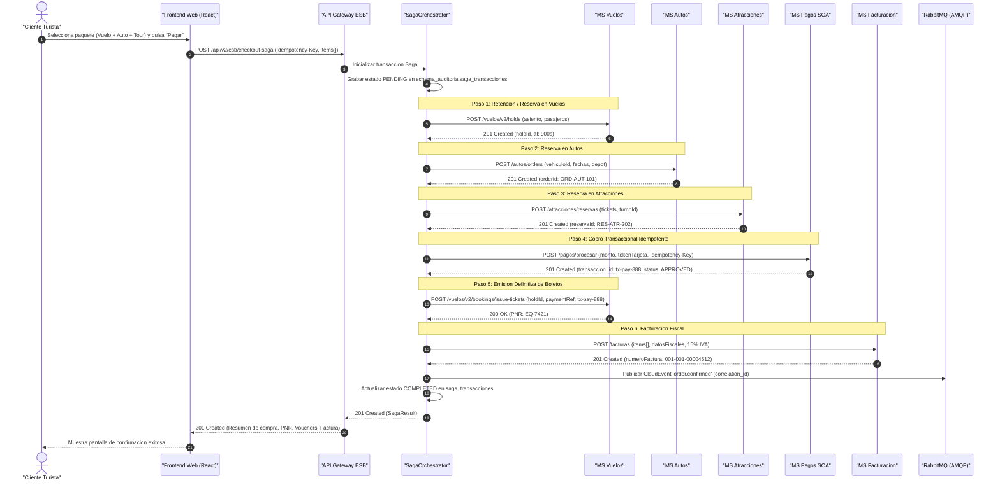
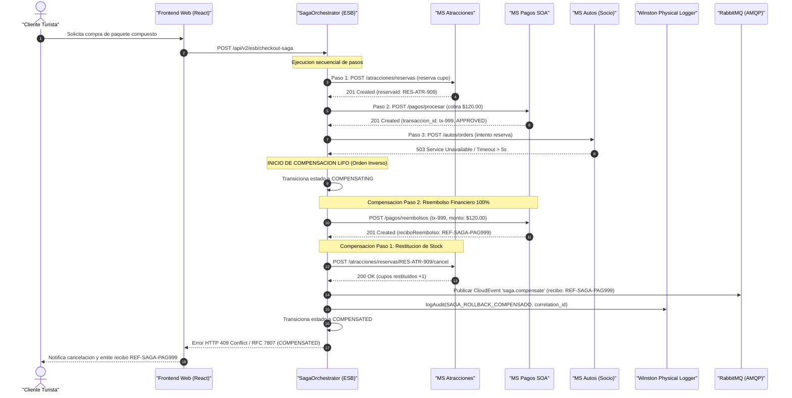
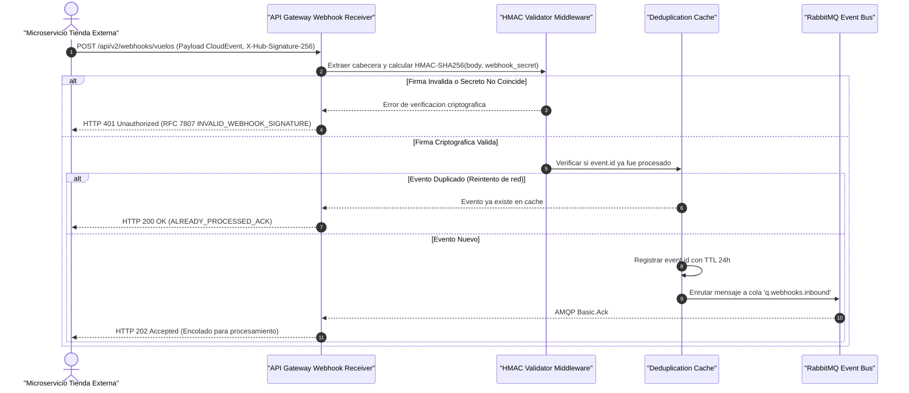
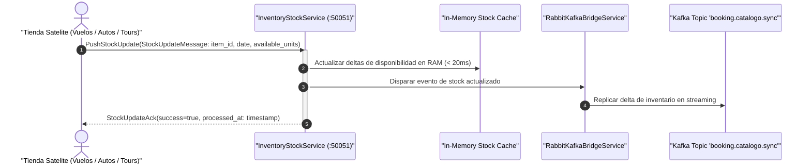
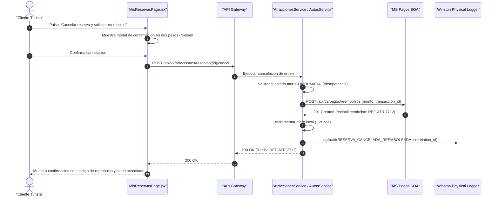
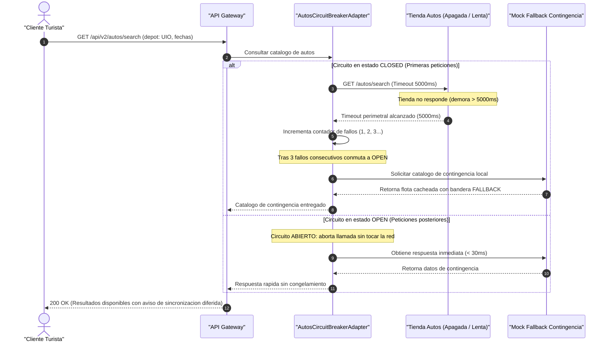

# Plan Maestro de Integración — Booking Prototipo (RDA2)

> **Asignatura:** Integración de Sistemas — 6to Semestre  
> **Proyecto:** Booking Prototipo (Marketplace Agregador Central y Gateway ESB/BFF)  
> **Documento:** Plan de Integración de Tiendas Satélites, Protocolos Asimétricos y Microservicios Internos  
> **Versión Estándar:** 2.0.0 (SemVer)  
> **Fecha:** Octubre 2026  
> **Estado:** Aprobado / Consolidado con Contratos Formales v2, Criterios CE01–CE11 y Arquitectura EDA  

---

## 1. Mapa de Integración y Contexto Arquitectónico

El **Booking Prototipo (RDA2)** opera como el nodo integrador central del ecosistema turístico. El siguiente diagrama de contexto ilustra la interacción entre el cliente web, el API Gateway / ESB, los microservicios internos desacoplados, los brokers de mensajería híbridos y las cuatro tiendas satélites externas desarrolladas por los equipos de compañeros:

```mermaid
graph TD
    subgraph Capa_Presentacion ["Capa de Presentacion"]
        UI["Frontend Web React 18 + Vite"]
        DASH["Consola de Administracion (8 Paneles)"]
    end

    subgraph API_Gateway_Core ["API Gateway / Router ESB / BFF (NestJS 10.x)"]
        GW["API Gateway Router (/api/v1 y /api/v2)"]
        GQL["GraphQL BFF Resolver (Puerto 3000 /graphql)"]
        CB["Circuit Breakers y ACL Adapters (Timeout 5s)"]
        SAGA["Orquestador Saga LIFO (Transaccional)"]
        GRPC_SVR["Servidor gRPC Inbound (Puerto 50051)"]
        CACHE[("Cache de Inventario en RAM")]
        BRIDGE["RabbitKafkaBridgeService (Cross-Broker)"]
        LOGGER["Winston Physical Logger (logs/*.log)"]
    end

    subgraph Microservicios_Internos ["Microservicios Internos Desacoplados"]
        MS_PAG["MS_PAG: Pasarela Pagos SOA"]
        MS_FAC["MS_FAC: Facturacion Fiscal"]
        MS_FIN["MS_FIN: Finanzas y Liquidaciones"]
        MS_PKG["MS_PKG: Paquetes y Combos B2B"]
        MS_CAR["MS_CAR: Carritos Persistentes"]
        MS_CLI["MS_CLI: Clientes y Perfiles"]
        MS_AUD["MS_AUD: Auditoria Forense"]
        MS_PROV["MS_PROV: Monitor 5 Nodos"]
    end

    subgraph Mensajeria_Hibrida ["Dual Event Bus"]
        RABBIT["RabbitMQ (AMQP 0-9-1)\nCanal Transaccional y Sagas\nExchange: booking.events"]
        KAFKA["Apache Kafka (Streaming)\nTelemetria, Auditoria y Replica\nTopics: booking.audit.*"]
    end

    subgraph Persistencia_Aislada ["Persistencia Supabase Cloud"]
        DB[("PostgreSQL 15+\n12 Esquemas Relacionales Aislados\nCero Cross-Schema Foreign Keys")]
    end

    subgraph Tiendas_Satelites ["Tiendas Externas (Equipos de Companeros)"]
        EXT_ATR["Tienda Atracciones (Descubre EC - Dilan)"]
        EXT_AUT["Tienda Renta de Autos (Partner Flota)"]
        EXT_ALO["Tienda Alojamientos (GDS Hoteles - Lizz)"]
        EXT_VUE["Tienda Vuelos (GDS Flight Core - Alejo)"]
    end

    UI -->|HTTPS REST / GraphQL + X-Correlation-Id| GW
    DASH -->|HTTPS REST Admin| GW
    GW --> GQL
    GW --> CB
    GW --> SAGA

    CB -->|REST Outbound + Idempotency-Key| EXT_ATR
    CB -->|REST Outbound + Idempotency-Key| EXT_AUT
    CB -->|REST Outbound + Idempotency-Key| EXT_ALO
    CB -->|REST Outbound + Idempotency-Key| EXT_VUE

    EXT_ATR -.->|gRPC PushStockUpdate / Puerto 50051| GRPC_SVR
    EXT_AUT -.->|gRPC PushStockUpdate / Puerto 50051| GRPC_SVR
    EXT_ALO -.->|gRPC PushStockUpdate / Puerto 50051| GRPC_SVR
    EXT_VUE -.->|gRPC PushStockUpdate / Puerto 50051| GRPC_SVR

    EXT_ATR -.->|Webhooks Inbound CloudEvents + HMAC| GW
    EXT_AUT -.->|Webhooks Inbound CloudEvents + HMAC| GW
    EXT_VUE -.->|Webhooks Inbound CloudEvents + HMAC| GW

    GRPC_SVR --> CACHE
    SAGA --> MS_PAG
    SAGA --> RABBIT
    RABBIT --> BRIDGE
    BRIDGE --> KAFKA

    MS_PAG --> DB
    MS_FAC --> DB
    MS_FIN --> DB
    MS_PKG --> DB
    MS_CAR --> DB
    MS_CLI --> DB
    MS_AUD --> DB
    MS_PROV --> DB

    GW -.->|Escritura fisica inmutable CERO logs en BD| LOGGER
```



---

## 2. Matriz de Integración por Tienda

La siguiente tabla resume los protocolos, esquemas de autenticación, estado de preparación y responsables de cada vertical externa:

| Tienda / Vertical | Protocolos de Comunicación | Mecanismos de Autenticación | Estado de Integración | Contrato Formal de Referencia | Responsable / Rol |
|---|---|---|:---:|---|---|
| **Atracciones Turísticas**<br>*(Descubre EC)* | • **REST Outbound:** Compras y cancelaciones (`POST /reservas`, `POST /reservas/{id}/cancel`).<br>• **gRPC Inbound:** Ingesta de aforos y slots (`PushStockUpdate` :50051).<br>• **Webhooks Inbound:** Notificaciones de cancelación y aforos. | `Bearer Token` de socio / `X-Api-Key` en REST; HMAC-SHA256 (`X-Hub-Signature-256`) en webhooks. | **Lista / Funcional** | [`contracts/atracciones-openapi-v2.yaml`](file:///c:/Users/aleji/Desktop/Semestre%206/Integracion%20de%20sistemas/Contratos/RDA1/contracts/atracciones-openapi-v2.yaml) | Dilan Mendoza (Tienda) / Paúl Rosero (Gateway) |
| **Renta de Autos**<br>*(Partner Flota)* | • **REST Outbound:** Órdenes, cancelaciones y check-in (`POST /autos/orders`, `POST /orders/{id}/cancel`).<br>• **gRPC Inbound:** Actualización de vehículos disponibles.<br>• **Webhooks Inbound:** Notificaciones de cooldown 2h e inspección. | `X-Api-Key` perimetral para partners; cabecera `Idempotency-Key` en mutaciones. | **Lista / Funcional** | [`contracts/autos-openapi-v2.yaml`](file:///c:/Users/aleji/Desktop/Semestre%206/Integracion%20de%20sistemas/Contratos/RDA1/contracts/autos-openapi-v2.yaml) | Responsable Flota (Tienda) / Paúl Rosero (Gateway) |
| **Vuelos**<br>*(GDS Flight Core)* | • **REST Outbound:** Búsqueda, Hold con TTL, emisión de PNRs (`/vuelos/v2/bookings`, `/vuelos/v2/holds`).<br>• **gRPC Inbound:** Sincronización de asientos y cabinas.<br>• **Webhooks Inbound:** Cambios de itinerario y cancelaciones. | `X-Api-Key` / OAuth2 Client Credentials; firma criptográfica HMAC en eventos salientes. | **Lista / Funcional** | [`contracts/vuelos-openapi-v2.yaml`](file:///c:/Users/aleji/Desktop/Semestre%206/Integracion%20de%20sistemas/Contratos/RDA1/contracts/vuelos-openapi-v2.yaml) | Alejo (Tienda) / Paúl Rosero (Gateway) |
| **Alojamientos**<br>*(GDS Hoteles)* | • **REST Outbound:** Catálogo, disponibilidad y check-in 14:00 (`GET /alojamientos`, `POST /reservas`).<br>• **gRPC Inbound:** Cupos de habitaciones remanentes. | `ProviderApiKey` (`X-Api-Key`); tokens Bearer en endpoints de clientes. | **Lista / Funcional** | [`contracts/alojamientos-openapi.yaml`](file:///c:/Users/aleji/Desktop/Semestre%206/Integracion%20de%20sistemas/Contratos/RDA1/contracts/alojamientos-openapi.yaml) | Lizz (Tienda) / Paúl Rosero (Gateway) |
| **Pasarela de Pagos (SOA)**<br>*(Simulador Interno)* | • **REST Inbound/Outbound:** Captura de cobros y emisión de reembolsos (`POST /pagos/procesar`, `POST /pagos/reembolsos`). | `SupabaseBearer` / `AdminKey` (`X-Admin-Key`) para inyección de fallos. | **Lista / Funcional** | [`contracts/pagos-openapi-v2.yaml`](file:///c:/Users/aleji/Desktop/Semestre%206/Integracion%20de%20sistemas/Contratos/RDA1/contracts/pagos-openapi-v2.yaml) | Paúl Rosero (Gateway) |

---

## 3. Diagramas de Secuencia de Integración

A continuación se presentan los **6 flujos secuenciales obligatorios** que gobiernan la interacción técnica en Booking Prototipo:

### 3.1 Flujo Feliz de Checkout Multivertical
Ilustra el proceso exitoso de compra compuesta orquestada por el ESB (Búsqueda → Hold/Reserva → Cobro Pasarela → Emisión → Factura Unificada):



---

### 3.2 Patrón Saga con Fallo y Compensación LIFO
Ilustra el rechazo de la tienda de autos tras haber cobrado el dinero, disparando la compensación atómica en orden inverso (LIFO) con recibo `REF-SAGA-XXXXXX`:



---

### 3.3 Receptor de Webhooks Inbound con Firma HMAC-SHA256
Ilustra la ingesta segura y desduplicación de eventos CloudEvents emitidos por tiendas socias:



---

### 3.4 Sincronización Continua de Inventario vía gRPC HTTP/2
Ilustra la absorción de alta frecuencia en el socket TCP puerto `50051`:



---

### 3.5 Flujo de Reembolso Financiero Indemnizatorio
Ilustra la solicitud de reembolso directo desde "Mis Reservas":



---

### 3.6 Resiliencia ante Tienda Caída: Circuit Breaker y Mock Fallback (CE01)
Ilustra la protección perimetral ante indisponibilidad de la tienda de autos:



---

## 4. Contratos de Datos Compartidos y Estándares de Integración

Para garantizar la interoperabilidad sin acoplamiento semántico entre las tiendas:

### 4.1 Identificadores Canónicos de Entidades
- **ID de Reserva / Orden:** Estructurados con prefijo normalizado de vertical seguido de UUID v4:
  - Atracciones: `RES-ATR-<UUID-v4>` (ej. `RES-ATR-f47ac10b-58cc-4372-a567-0e02b2c3d479`)
  - Autos: `ORD-AUT-<UUID-v4>`
  - Vuelos: Código PNR de 6 caracteres alfanuméricos IATA (ej. `EQ-7421`) o `BKG-VUE-<UUID>`
  - Alojamientos: `RES-ALO-<UUID-v4>`
- **Referencia Única de Pago (`paymentReference`):** Identificador generado por `MS_PAG` con formato `PAY-<TIMESTAMP>-<HASH>` (ej. `PAY-20261024-A8F2C1`). Este código viaja hacia las aerolíneas y socios para certificar la captura del cobro antes de la emisión de tickets.
- **Trazabilidad Universal (`correlation_id`):** Formato `cid-<UUID-v4>`. Obligatorio en cabecera HTTP `X-Correlation-Id`, metadatos de Protocol Buffers (`correlation_id`), frames AMQP de RabbitMQ y headers de Apache Kafka.

### 4.2 Formatos Estándar de Tiempo y Moneda
- **Marcas de Tiempo (Timestamps):** Formato estricto **ISO 8601 UTC** con resolución de milisegundos: `YYYY-MM-DDTHH:mm:ss.sssZ` (ej. `2026-10-24T22:30:00.000Z`). En mensajes binarios gRPC se admite Epoch Unix en milisegundos (`int64 timestamp`).
- **Moneda e Importes Financieros:** Todos los montos se liquidan en Dólares de los Estados Unidos (**USD**), representados como números decimales con exactamente 2 dígitos (`number`, `0.00`) para evitar discrepancias de redondeo en pasarela.

### 4.3 Tabla de Equivalencia de Eventos entre Tiendas y Booking

| Dominio Semántico | Booking Prototipo (Gateway) | Tienda Vuelos (GDS) | Tienda Autos (Flota) | Tienda Atracciones |
|---|---|---|---|---|
| **Reserva Confirmada** | `order.confirmed` | `flight.booking.confirmed` | `auto.order.created` | `reserva.atraccion.creada` |
| **Reserva Cancelada** | `order.cancelled` | `flight.booking.cancelled` | `auto.order.cancelled` | `reserva.atraccion.cancelada` |
| **Check-in Completado** | `checkin.completed` | `flight.boarding_pass.issued` | `auto.checkin.entrega` | `reserva.atraccion.checked_in` |
| **Stock Actualizado** | `stock.updated` | `flight.seats.updated` | `auto.fleet.availability_changed` | `atraccion.aforo.modificado` |
| **Reembolso Emitido** | `payment.refunded` | `flight.refund.processed` | `auto.refund.issued` | `atraccion.reembolso.emitido` |

---

## 5. Orden de Integración, Hitos y Criterios de "Listo" (DoD)

La integración del ecosistema se estructura en **5 hitos secuenciales** gobernados por dependencias técnicas:

```mermaid
gantt
    title Cronograma de Hitos de Integracion RDA2
    dateFormat  YYYY-MM-DD
    section Hitos
    Hito 1: Perimetro y Resiliencia CE01       :done,    h1, 2026-10-10, 2026-10-14
    Hito 2: gRPC Inbound y Catalogo Agregado    :done,    h2, 2026-10-14, 2026-10-18
    Hito 3: Sagas y Transaccionalidad LIFO      :done,    h3, 2026-10-18, 2026-10-22
    Hito 4: Dual Event Bus y Webhooks           :active,  h4, 2026-10-22, 2026-10-26
    Hito 5: Facturacion y Finanzas B2B          :         h5, 2026-10-26, 2026-10-30
```

### 5.1 Definición de Hitos y Pruebas Asociadas

1. **Hito 1 — Perímetro y Resiliencia CE01:**
   - *Alcance:* Configuración de Circuit Breakers perimetrales en adaptadores ACL, timeouts de 5000 ms y Mock Fallback automático.
   - *Pruebas de Validación:* `CP-004` (`circuit-breaker-resilience.spec.ts` 10/10 PASS).
   - *Criterio de Listo (DoD):* Ninguna caída de tienda congela el Gateway ni emite errores 500.
2. **Hito 2 — Ingesta gRPC y Catálogo Agregado:**
   - *Alcance:* Montaje de socket TCP `50051` (`inventory.proto`), caché en RAM y catálogo multivertical en GraphQL BFF.
   - *Pruebas de Validación:* `CP-014` (`test-grpc-inventory.js`) y `CP-015` (Query `catalogoUnificado`).
   - *Criterio de Listo (DoD):* Actualizaciones de cupos procesadas en $\le 50\text{ ms}$ y catálogo expuesto en `/graphql`.
3. **Hito 3 — Sagas Transaccionales y Compensaciones LIFO:**
   - *Alcance:* Orquestación de compras multi-tienda, validación de `Idempotency-Key` y reverso de reservas con reembolso 100%.
   - *Pruebas de Validación:* `CP-001` (Saga feliz) y `CP-002` (`test-cancel-saga.js`).
   - *Criterio de Listo (DoD):* Fallo en cualquier paso revierte atómicamente en orden LIFO y emite comprobante `REF-...`.
4. **Hito 4 — Event Bus Dual y Receptor de Webhooks:**
   - *Alcance:* Publicación en RabbitMQ (`booking.events`), puente hacia Kafka (`booking.audit.*`) y receptor HMAC en `WebhooksModule`.
   - *Pruebas de Validación:* `CP-010` (Webhooks con firma) y `CP-013` (Trazabilidad cross-broker).
   - *Criterio de Listo (DoD):* Eventos con formato CloudEvents v1.0 y firmas HMAC validadas sin bypass.
5. **Hito 5 — Facturación Fiscal y Liquidaciones B2B:**
   - *Alcance:* Persistencia fiscal en `schema_facturacion`, cálculo de 15% IVA, liquidaciones quincenales (`Q1`/`Q2`) y libro mayor.
   - *Pruebas de Validación:* `CP-022` (Liquidaciones) y `CP-023` (Factura compuesta ESB).
   - *Criterio de Listo (DoD):* Asientos contables cuadrados y reportes financieros auditables por socio.

---

## 6. Matriz de Riesgos Técnicos y Estrategias de Mitigación

| ID Riesgo | Descripción del Riesgo Técnico | Probabilidad | Impacto | Nivel de Severidad | Estrategia de Mitigación Implementada |
|:---:|---|:---:|:---:|:---:|---|
| **R-01** | **Contratos Desalineados entre Tiendas:** Desincronización en nombres de campos (camelCase vs snake_case) o eliminación de rutas por parte de un equipo. | Media | Alto | 🔴 **Alta** | **Capa Anti-Corrupción (ACL):** Los adaptadores de Booking transforman y normalizan los payloads satélites al modelo interno; pruebas de contrato automatizadas (`test/integration/*.contract.spec.ts`) alertan divergencias antes de producción. |
| **R-02** | **Latencia Excesiva o Tienda Caída en Evaluación:** La tienda externa de un compañero se apaga o su conexión tarda más de 5 segundos. | Alta | Crítico | 🔴 **Alta** | **Circuit Breaker y Mock Fallback (CE01):** Timeout forzado a los 5000 ms; conmutación automática al catálogo de contingencia con bandera `CONFIRMED_FALLBACK` garantizando que el usuario nunca experimente pantallas congeladas ni errores 500. |
| **R-03** | **Suspensión de Servicios Gratuitos en la Nube (Render Cold Start):** El backend en Render entra en reposo (*sleeping*) tras 15 minutos de inactividad, demorando hasta 50s en responder el primer ping. | Alta | Medio | 🟡 **Media** | **Keep-Alive Cron / Warmup:** Configuración de pings periódicos desde UptimeRobot o desde el frontend para mantener activo el contenedor; pruebas locales como respaldo inmediato para la sustentación docente. |
| **R-04** | **Fuga o Exposición Involuntaria de Claves Secretas:** Filtración de tokens de Supabase, API Keys privadas de socios o llaves de webhook en commits de Git. | Baja | Crítico | 🔴 **Alta** | **Aislamiento Estricto de Secretos:** Exclusión rigurosa de `.env` y `.env.*` en `.gitignore`; regla de cero secretos en contratos; inyección exclusiva mediante `ConfigService` de NestJS en runtime. |
| **R-05** | **Saturación de Conexiones por Telemetría Masiva:** El registro de miles de métricas de frontend degrada la base de datos relacional. | Media | Alto | 🟡 **Media** | **Arquitectura Híbrida Desacoplada (ADR-003):** 100% de logs técnicos en archivos planos Winston en disco; telemetría streaming en Kafka sin tocar las tablas transaccionales de PostgreSQL. |

---

## 7. Checklist de Integración para Equipos de Tiendas

Para facilitar el enganche de sus servicios con el API Gateway de Booking Prototipo, cada equipo de tienda debe proporcionar y validar los siguientes elementos:

- [ ] **1. Endpoint Base HTTPS:** URL pública accesible en Internet (o túnel ngrok para pruebas) con protocolo HTTPS activo y certificado TLS válido.
- [ ] **2. Soporte de Cabeceras Estándar:**
  - `Idempotency-Key`: Aceptación obligatoria de cabecera UUID en mutaciones de compra y cancelación para evitar dobles reservas.
  - `X-Correlation-Id`: Propagación intacta del identificador de trazabilidad en los encabezados de respuesta.
- [ ] **3. Cumplimiento de Formato de Error RFC 7807:** Respuestas 4xx y 5xx estructuradas con cabecera `Content-Type: application/problem+json` (`type`, `title`, `status`, `detail`).
- [ ] **4. Cliente gRPC HTTP/2 (Puerto 50051):** Capacidad de conectarse al servidor gRPC de Booking (`inventory.proto`) y emitir mensajes `PushStockUpdate` cada vez que su stock cambie.
- [ ] **5. Acuerdos de Promoción B2B Formalizados:** Implementación de `GET/PUT /promociones/contrato` respondiendo `permite_promociones` y `porcentaje_descuento_maximo` (Mandato de Cátedra pág. 149).
- [ ] **6. Secreto Compartido de Webhooks:** Configuración de clave criptográfica secreta y firma de eventos CloudEvents v1.0 mediante `X-Hub-Signature-256`.

---
*Fin del Plan Maestro de Integración RDA2.*
