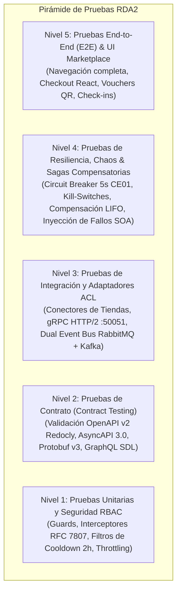

# Plan Maestro de Pruebas — Booking Prototipo (RDA2)

> **Asignatura:** Integración de Sistemas — 6to Semestre  
> **Proyecto:** Booking Prototipo (Marketplace Agregador Central y Gateway ESB/BFF)  
> **Documento:** Plan de Pruebas de Software, Resiliencia y Validación de Contratos Distribuidos  
> **Versión Estándar:** 2.0.0 (SemVer)  
> **Fecha:** Octubre 2026  
> **Estado:** Aprobado / Consolidado con Contratos v2, Matriz de Evidencias RDA2 (CE01–CE11) y Suites Automatizadas  

---

## 1. Estrategia y Pirámide de Pruebas

El aseguramiento de la calidad de **Booking Prototipo (RDA2)** se fundamenta en un modelo de **Pirámide de Pruebas Adaptada a Arquitecturas Distribuidas Orientadas a Eventos (EDA) y Microservicios**, garantizando cobertura desde la lógica unitaria hasta la resiliencia en red:



### 1.1 Niveles de Prueba
1. **Nivel 1 — Unitarias y Seguridad RBAC:** Validan controladores, servicios aislados, sanitización de entradas, inmunidad UUID y autorización perimetral de roles (`CLIENTE`, `ADMIN`, `MANTENIMIENTO`).
2. **Nivel 2 — Pruebas de Contrato (Contract Testing):** Verifican que la sintaxis de las especificaciones OpenAPI 3.0.3, AsyncAPI 3.0, Protocol Buffers y GraphQL sea 100% válida (0 errores) y que los esquemas de respuesta coincidan estrictamente con los contratos pactados con los compañeros.
3. **Nivel 3 — Integración de Servicios:** Evalúan la interoperabilidad entre microservicios, persistencia aislada *Database-per-Service* (12 esquemas relacionales sin FKs cross-schema) y adaptadores ACL.
4. **Nivel 4 — Resiliencia y Sagas Compensatorias:** Verifican el comportamiento del sistema ante condiciones adversas (tiendas externas caídas, timeouts de 5000 ms, apertura de Circuit Breakers, conmutación a Mock Fallback y compensaciones LIFO automáticas con reembolso monetario).
5. **Nivel 5 — End-to-End (E2E) y Navegación Web:** Pruebas integradas de flujos de usuario (búsqueda multivertical, armado de combos con descuento, compra orquestada, check-ins y cancelaciones en "Mis Reservas").

---

### 1.2 Ambientes de Prueba y Configuración

| Ambiente | Propósito | URL / Endpoint Base | Tecnologías y Servicios Asociados |
|---|---|---|---|
| **Local (Development)** | Ejecución de pruebas unitarias, integración local y depuración interactiva. | `http://localhost:3000/api/v2`<br>`http://localhost:5173` (Frontend)<br>`localhost:50051` (gRPC TCP) | Node.js v20.x, NestJS 10.x, React 18 + Vite, Supabase Local / In-memory Mocks, Winston Physical Logger en `logs/`. |
| **Producción en la Nube (Cloud)** | Demostración formal y evaluación perimetral docente en Internet (HTTPS). | `https://rda1-backend-integracion-sistemas.onrender.com/api/v2`<br>Vercel Web App | Render (Web Service Node.js), Vercel (SPA estática React), Supabase Cloud (PostgreSQL 15+ con 12 esquemas independientes). |
| **Simulador Financiero SOA** | Inyección controlada de fallos de pasarela (`TIMEOUT_RED`, `RECHAZO_FONDOS`). | `http://localhost:3000/api/v2/pagos/simulador/config` | Módulo `MS_PAG` con endpoints administrativos para forzar fallas controladas y validar la compensación Saga. |

---

## 2. Inventario de Pruebas Existentes en el Repositorio

A continuación se detalla el catálogo de suites de prueba ya implementadas en el código fuente:

| Archivo de Prueba | Nivel / Tipo | Casos / Escenarios que Cubre | Comando Oficial de Ejecución | Estado |
|---|:---:|---|---|:---:|
| [`test/integration/circuit-breaker-resilience.spec.ts`](file:///c:/Users/aleji/Desktop/Semestre%206/Integracion%20de%20sistemas/Contratos/RDA1/test/integration/circuit-breaker-resilience.spec.ts) | Resiliencia / Integración | **Criterio Excluyente CE01:** Timeout perimetral estricto de 5000 ms ante tienda apagada, apertura de Circuit Breaker tras 3 fallos consecutivos, activación de Mock Fallback de contingencia (`CONFIRMED_FALLBACK`), y conmutación de Kill-Switches en memoria y base de datos. (10/10 tests PASS). | `npx jest --config jest-contracts.config.js test/integration/circuit-breaker-resilience.spec.ts` | **Ejecutando (10/10 PASS)** |
| [`test/integration/atracciones.contract.spec.ts`](file:///c:/Users/aleji/Desktop/Semestre%206/Integracion%20de%20sistemas/Contratos/RDA1/test/integration/atracciones.contract.spec.ts) | Contrato v2 | Validación de contrato de Atracciones v2: estructura de categorías jerárquicas, aforo diferenciado por edad (infante $0 pero 1 cupo), slots horarios y cancelaciones compensatorias. | `npx jest --config jest-contracts.config.js test/integration/atracciones.contract.spec.ts` | **Ejecutando (PASS)** |
| [`test/integration/autos.contract.spec.ts`](file:///c:/Users/aleji/Desktop/Semestre%206/Integracion%20de%20sistemas/Contratos/RDA1/test/integration/autos.contract.spec.ts) | Contrato v2 | Validación de contrato de Autos v2: cotización con sobretasa por conductor joven, máquina de estados finita de flota y rechazo HTTP 409 ante reserva en cooldown de 2 horas. | `npx jest --config jest-contracts.config.js test/integration/autos.contract.spec.ts` | **Ejecutando (PASS)** |
| [`test/test-cancel-saga.js`](file:///c:/Users/aleji/Desktop/Semestre%206/Integracion%20de%20sistemas/Contratos/RDA1/test/test-cancel-saga.js) | Sagas / Integración | Flujo de cancelación compensatoria transaccional LIFO: reverso de stock en atracciones (`cupos += tickets`), emisión de recibo de reembolso 100% (`REF-...`), y registro en log físico Winston. | `node test/test-cancel-saga.js` | **Ejecutando (PASS)** |
| [`test/test-nodes-monitor.js`](file:///c:/Users/aleji/Desktop/Semestre%206/Integracion%20de%20sistemas/Contratos/RDA1/test/test-nodes-monitor.js) | Observabilidad | Monitoreo en vivo del Semáforo de 5 nodos, medición de latencia en milisegundos y conmutación dinámica de Kill-Switches. | `node test/test-nodes-monitor.js` | **Ejecutando (PASS)** |
| [`test/test-grpc-inventory.js`](file:///c:/Users/aleji/Desktop/Semestre%206/Integracion%20de%20sistemas/Contratos/RDA1/test/test-grpc-inventory.js) | gRPC / Protocol Buffers | Ingesta de stock de alta frecuencia por socket TCP `50051` (`PushStockUpdate` y `StreamInventoryChanges`) contra `inventory.proto`. | `node test/test-grpc-inventory.js` | **Ejecutando (PASS)** |
| [`test/test-sanitization-rfc7807.js`](file:///c:/Users/aleji/Desktop/Semestre%206/Integracion%20de%20sistemas/Contratos/RDA1/test/test-sanitization-rfc7807.js) | Seguridad / Formatos | Blindaje frente a inyecciones de caracteres infinitos, colapso de espacios en blanco duplicados, validación previa UUID anti errores 500 y formato Problem Details RFC 7807. | `node test/test-sanitization-rfc7807.js` | **Ejecutando (PASS)** |
| [`src/modules/admin/admin-seguridad.spec.ts`](file:///c:/Users/aleji/Desktop/Semestre%206/Integracion%20de%20sistemas/Contratos/RDA1/src/modules/admin/admin-seguridad.spec.ts) | Seguridad / RBAC | 17 pruebas unitarias de autorización por roles: rechazo HTTP 403 Forbidden para usuarios `CLIENTE` o tokens no autorizados accediendo a operaciones de administración. | `npx jest src/modules/admin/admin-seguridad.spec.ts` | **Ejecutando (17/17 PASS)** |
| [`run_api_tests.js`](file:///c:/Users/aleji/Desktop/Semestre%206/Integracion%20de%20sistemas/Contratos/RDA1/run_api_tests.js) | API / Clientes | 32 pruebas funcionales y de seguridad de la API de Clientes (autenticación JWT, expiración, firmas alteradas, sanitización de inputs y validación de correo). | `npm run test:api:clientes` | **Ejecutando (32/32 PASS)** |
| **Suite de Linters de Contratos** | Contratos Formales | Validación sintáctica oficial de los 11 contratos OpenAPI v2 con Redocly CLI y de AsyncAPI 3.0 con AsyncAPI CLI. | `npx --yes @redocly/cli@1 lint contracts/*-openapi-v2.yaml`<br>`npx --yes @asyncapi/cli validate contracts/asyncapi-eventos-v2.yaml` | **Ejecutando (0 errores)** |

---

## 3. Casos de Prueba Obligatorios y Detallados

A continuación se presentan los casos de prueba formales, estructurados con identificador `CP-NNN`, precondiciones, pasos, datos de prueba, resultado esperado, tipo, automatización y trazabilidad a requisitos:

### 🌟 3.1 Casos de Prueba Obligatorios de Cátedra (CP-001 a CP-013)

#### `CP-001`: Saga Feliz — Compra Compuesta Multivertical Exitosa
- **RF / RNF Vinculados:** `RF-SAGA-01`, `RF-PAG-01`, `RF-FAC-01`, `RF-FAC-05`, `RF-EVT-01`, `RNF-RES-04`, `RNF-IDM-01`.
- **Tipo:** Integración / Saga Transaccional.
- **Automatizable:** Sí (Jest / Script Node).
- **Estado:** `Existe` (`test/test-cancel-saga.js` adaptado a happy path y `SagaOrchestratorService`).
- **Precondiciones:** Backend activo, nodos de atracciones y autos en estado `ONLINE` (🟢), y pasarela de pagos en modo estándar.
- **Pasos:**
  1. Enviar una petición `POST /api/v2/esb/checkout-saga` con cabecera `Idempotency-Key: saga-happy-001` y `X-Correlation-Id: cid-happy-001`.
  2. Incluir en el payload ítems para: 1 tour de atracciones ($40.00), 1 arriendo de auto ($60.00) y datos de tarjeta de crédito simulada.
  3. Verificar la respuesta del ESB y la persistencia en base de datos.
- **Datos de Entrada (Payload JSON):**
  ```json
  {
    "cliente": { "id": "usr-test-01", "email": "turista@booking.com", "nombre": "Juan Pérez" },
    "items": [
      { "vertical": "atracciones", "servicioId": "PRhu4UBTWPBC", "monto": 40.0, "detalles": { "tickets": 2, "turnoId": "turno-777" } },
      { "vertical": "autos", "servicioId": "auto-sedan-01", "monto": 60.0, "detalles": { "dias": 2, "depot": "UIO" } }
    ],
    "metodoPago": { "tipo": "TARJETA_SIMULADA", "token": "tok_visa_valid" },
    "total": 100.0
  }
  ```
- **Resultado Esperado:** Código HTTP 201 Created. Objeto de respuesta con `estado: "COMPLETED"`, `transaccion_id` asignado, comprobante fiscal emitido y registros asentados en `schema_auditoria.saga_pasos_journal` con todos los pasos en `EXITO`.

---

#### `CP-002`: Saga con Fallo en Autos y Compensación LIFO (Reverso y Reembolso)
- **RF / RNF Vinculados:** `RF-SAGA-02`, `RF-PAG-02`, `RF-ATR-01`, `RF-EVT-01`, `RNF-RES-04`.
- **Tipo:** Resiliencia / Patrón Saga Compensatoria.
- **Automatizable:** Sí (`node test/test-cancel-saga.js`).
- **Estado:** `Existe` (`test/test-cancel-saga.js`).
- **Precondiciones:** Nodo de atracciones operativo; nodo de autos configurado para simular fallo 503 o rechazo de confirmación; pasarela de pagos activa.
- **Pasos:**
  1. El orquestador ejecuta el Paso 1: Reserva de atracción exitosa (descuenta 2 cupos en `turno-777`).
  2. El orquestador ejecuta el Paso 2: Cobra $100.00 exitosamente en `MS_PAG`.
  3. El orquestador ejecuta el Paso 3: Envía orden a tienda de autos, la cual responde con HTTP 503 Service Unavailable.
  4. Se activa el motor de compensación LIFO del `SagaOrchestratorService`.
- **Resultado Esperado:** 
  1. El orquestador invoca en orden inverso las compensaciones: emite reembolso monetario del 100% ($100.00) en `MS_PAG` con recibo `REF-...`.
  2. Invoca el reverso de cupos en atracciones (`cupos += 2`), dejando el aforo del turno intacto.
  3. El estado global de la Saga transiciona a `COMPENSATED`.
  4. Se escribe la traza compensatoria en `logs/audit-YYYY-MM-DD.log` con el mismo `correlation_id`.

---

#### `CP-003`: Saga con Fallo en Pasarela de Pagos (Rechazo de Fondos)
- **RF / RNF Vinculados:** `RF-SAGA-02`, `RF-PAG-03`, `RNF-RES-04`.
- **Tipo:** Resiliencia / Fallo Financiero.
- **Automatizable:** Sí.
- **Estado:** `Existe` (Integrado en `SagaOrchestratorService`).
- **Precondiciones:** Pasarela de pagos configurada con `modo: "FORZAR_RECHAZO"` vía `POST /pagos/simulador/config`.
- **Pasos:**
  1. Enviar solicitud de checkout multivertical.
  2. El orquestador reserva provisionalmente cupos en las tiendas.
  3. Al intentar capturar el cobro en `POST /pagos/procesar`, la pasarela responde HTTP 402 Payment Required (`RECHAZO_FONDOS`).
- **Resultado Esperado:** El orquestador intercepta el rechazo financiero, ejecuta la compensación liberando los cupos provisionales de las tiendas y retorna al cliente un error RFC 7807 con código `PAYMENT_REJECTED` sin cargos pendientes.

---

#### `CP-004`: Circuit Breaker Abierto (Timeout 5000 ms) y Mock Fallback (CE01)
- **RF / RNF Vinculados:** `RF-OBS-03`, `RNF-PERF-02`, `RNF-RES-01`, `RNF-RES-02`.
- **Tipo:** Resiliencia Perimetral / Rúbrica RDA2 CE01.
- **Automatizable:** Sí (`test/integration/circuit-breaker-resilience.spec.ts`).
- **Estado:** `Existe` (10/10 PASS).
- **Precondiciones:** Tienda externa de autos o atracciones apagada, inalcanzable o respondiendo con delay > 6000 ms.
- **Pasos:**
  1. El cliente o Gateway emite peticiones hacia la tienda externa a través del conector ACL (`AutosCircuitBreakerAdapter`).
  2. Disparar 3 peticiones consecutivas donde cada llamada excede los 5000 ms.
  3. Emitir una 4ta petición inmediatamente después.
- **Resultado Esperado:** 
  1. Las primeras 3 peticiones son abortadas exactamente a los 5000 ms por timeout perimetral.
  2. El Circuit Breaker transiciona de `CLOSED` a `OPEN`.
  3. La 4ta petición no sale a la red: es interceptada de inmediato (< 50 ms) y el adaptador entrega el **Mock Fallback automático de contingencia**, entregando el catálogo local y confirmando reservas con indicador `CONFIRMED_FALLBACK` y `external_sync_pending: true`. Cero excepciones 500.

---

#### `CP-005`: Kill-Switch Dinámico de Nodos en Caliente
- **RF / RNF Vinculados:** `RF-OBS-02`, `RF-ADM-06`, `RNF-RES-03`.
- **Tipo:** Observabilidad y Administración.
- **Automatizable:** Sí (`test/integration/circuit-breaker-resilience.spec.ts` y `test/test-nodes-monitor.js`).
- **Estado:** `Existe`.
- **Precondiciones:** Usuario autenticado con rol `ADMIN`. Nodo `atracciones` en estado `HEALTHY` (🟢).
- **Pasos:**
  1. Ejecutar `POST /api/v2/admin/nodes/atracciones/toggle-killswitch` con cabecera de autenticación admin.
  2. Consultar el estado del semáforo con `GET /api/v2/admin/nodes/health`.
  3. Enviar una búsqueda de atracciones en el marketplace.
- **Resultado Esperado:**
  1. El estado del nodo conmuta a `MANUALLY_OPEN` (🔴 `APAGADO`) en memoria RAM y en `schema_proveedores.config_proveedor` en < 100 ms sin reiniciar el proceso.
  2. Las búsquedas en marketplace responden transparentemente desde el Mock Fallback local.
  3. Se asienta el evento `KILL_SWITCH_PROVEEDOR_ALTERADO` en `logs/audit-YYYY-MM-DD.log`.

---

#### `CP-006`: Idempotencia Estricta con Misma `Idempotency-Key`
- **RF / RNF Vinculados:** `RF-PAG-01`, `RF-SAGA-01`, `RNF-IDM-01`.
- **Tipo:** Consistencia / Idempotencia.
- **Automatizable:** Sí.
- **Estado:** `Existe` (`src/modules/pagos/pagos.service.ts`).
- **Precondiciones:** Pasarela de pagos en estado normal.
- **Pasos:**
  1. Enviar `POST /api/v2/pagos/procesar` con `Idempotency-Key: pay-idem-999` y monto $50.00.
  2. Verificar que la transacción sea creada con código HTTP 201 y `id: "tx-1"`.
  3. Reenviar exactamente la misma petición con los mismos parámetros e idéntica `Idempotency-Key: pay-idem-999`.
- **Resultado Esperado:** La segunda petición responde con HTTP 200/201 entregando el mismo `id: "tx-1"` original, sin insertar un nuevo registro en `schema_pagos.transacciones_pago` ni duplicar el débito financiero.

---

#### `CP-007`: Inyección de Fallos Dinámica en el Simulador de Pagos
- **RF / RNF Vinculados:** `RF-PAG-03`, `RNF-RES-04`.
- **Tipo:** Simulación / Chaos Testing.
- **Automatizable:** Sí.
- **Estado:** `Existe`.
- **Precondiciones:** Acceso al endpoint administrativo de pagos.
- **Pasos:**
  1. Ejecutar `POST /api/v2/pagos/simulador/config` con payload `{"modo": "FORZAR_TIMEOUT", "latenciaMs": 6000}`.
  2. Ejecutar una orden de pago mediante `POST /api/v2/pagos/procesar`.
- **Resultado Esperado:** La pasarela suspende la respuesta durante 6000 ms y retorna un error RFC 7807 `TIMEOUT_RED`, permitiendo verificar el comportamiento del cliente ante demoras extremas.

---

#### `CP-008`: Reembolso Financiero Idempotente y Mitigación de Duplicados
- **RF / RNF Vinculados:** `RF-PAG-02`, `RF-SAGA-02`, `RNF-IDM-02`.
- **Tipo:** Consistencia Financiera.
- **Automatizable:** Sí (`test/test-cancel-saga.js`).
- **Estado:** `Existe`.
- **Precondiciones:** Transacción previa aprobada `tx-original` por $80.00.
- **Pasos:**
  1. Enviar `POST /api/v2/pagos/reembolsos` referenciando `tx-original`.
  2. Verificar la emisión del comprobante `REF-...`.
  3. Enviar nuevamente una solicitud de reembolso sobre `tx-original`.
- **Resultado Esperado:** La segunda solicitud es interceptada y rechazada con código HTTP 400 y mensaje RFC 7807 `ALREADY_REFUNDED`, impidiendo fugas de capital o dobles reintegros.

---

#### `CP-009`: Creación de Paquete con Descuento Superior al Tope B2B
- **RF / RNF Vinculados:** `RF-PKG-01`, `RF-PKG-05`, `RNF-CMP-01`.
- **Tipo:** Cumplimiento de Reglas de Negocio B2B.
- **Automatizable:** Sí.
- **Estado:** `Existe` (`src/modules/paquetes/paquetes.service.ts`).
- **Precondiciones:** Contrato de atracciones en `schema_paquetes.contratos_promociones` con `porcentaje_descuento_maximo: 15.0`.
- **Pasos:**
  1. Enviar `POST /api/v2/paquetes/dinamico` solicitando un paquete combo con `descuento_solicitado: 25.0%`.
- **Resultado Esperado:** El servicio detecta que el 25% excede el límite del socio (15%), ajusta automáticamente el descuento al tope permitido del 15.0%, persiste el paquete inmutable y retorna el resumen con el descuento corregido.

---

#### `CP-010`: Receptor de Webhooks Inbound con Validación HMAC-SHA256
- **RF / RNF Vinculados:** `RF-WH-01`, `RF-WH-02`, `RNF-SEC-06`.
- **Tipo:** Seguridad Criptográfica / Integración Asíncrona.
- **Automatizable:** Sí.
- **Estado:** `Por Crear` (Especificado en `webhooks-inbound-openapi-v2.yaml`, programado para Sprint I04).
- **Precondiciones:** Secreto compartido de webhook `secret_vuelos_key` configurado en el gateway.
- **Pasos:**
  1. Generar payload CloudEvent de cambio de horario de vuelo.
  2. **Subcaso A (Válido):** Firmar el payload con HMAC-SHA256 y enviarlo en cabecera `X-Hub-Signature-256`.
  3. **Subcaso B (Firma Inválida):** Enviar el payload con una firma aleatoria o adulterada.
- **Resultado Esperado:**
  - Subcaso A: HTTP 202 Accepted. El evento se valida y enruta al Event Bus.
  - Subcaso B: HTTP 401 Unauthorized con formato RFC 7807 `INVALID_WEBHOOK_SIGNATURE`.

---

#### `CP-011`: Control de Acceso RBAC: Cliente Intentando Rutas de Administrador
- **RF / RNF Vinculados:** `RF-CLI-05`, `RF-ADM-01`, `RNF-SEC-02`.
- **Tipo:** Seguridad / Autorización Perimetral.
- **Automatizable:** Sí (`src/modules/admin/admin-seguridad.spec.ts`).
- **Estado:** `Existe` (17/17 PASS).
- **Precondiciones:** Token JWT válido emitido para un usuario con rol `CLIENTE`.
- **Pasos:**
  1. Enviar `GET /api/v2/admin/stats` incluyendo el Bearer Token del cliente.
  2. Enviar `POST /api/v2/admin/nodes/autos/toggle` con el mismo token.
- **Resultado Esperado:** El `RolesGuard` intercepta ambas solicitudes antes de llegar al handler del controlador y responde inmediatamente con HTTP 403 Forbidden bajo RFC 7807.

---

#### `CP-012`: Validación Sintáctica de Contratos OpenAPI v2 y Contract Testing
- **RF / RNF Vinculados:** `RNF-INT-03`, `RNF-MNT-02`, `CE07`.
- **Tipo:** Integridad de Contratos.
- **Automatizable:** Sí (CLI Redocly + Jest).
- **Estado:** `Existe` (`npm run test:contracts`).
- **Precondiciones:** Dependencias `@redocly/cli` y `@asyncapi/cli` instaladas.
- **Pasos:**
  1. Ejecutar linters de contratos:
     ```bash
     npx --yes @redocly/cli@1 lint contracts/*-openapi-v2.yaml
     npx --yes @asyncapi/cli validate contracts/asyncapi-eventos-v2.yaml
     ```
  2. Ejecutar la suite de pruebas de contrato Jest (`test/integration/atracciones.contract.spec.ts` y `autos.contract.spec.ts`).
- **Resultado Esperado:** 0 errores sintácticos en los 11 contratos OpenAPI v2. Las respuestas reales del servidor cumplen estrictamente con los esquemas JSON declarados en los contratos.

---

#### `CP-013`: Trazabilidad Distribuida de Extremo a Extremo (`X-Correlation-Id`)
- **RF / RNF Vinculados:** `RF-OBS-01`, `RF-EVT-01`, `RF-EVT-03`, `RNF-OBS-01`.
- **Tipo:** Observabilidad Transversal.
- **Automatizable:** Sí.
- **Estado:** `Existe` (`src/core/middleware/correlation-id.middleware.ts` y `logs/`).
- **Precondiciones:** Gateway NestJS en ejecución.
- **Pasos:**
  1. Emitir una solicitud `POST /api/v2/esb/checkout-saga` inyectando la cabecera `X-Correlation-Id: test-trace-e2e-777`.
  2. Verificar los encabezados de respuesta HTTP.
  3. Inspeccionar el archivo físico `logs/integration-YYYY-MM-DD.log`.
  4. Inspeccionar el payload del mensaje emitido a RabbitMQ/Kafka.
- **Resultado Esperado:**
  1. La cabecera `X-Correlation-Id: test-trace-e2e-777` se devuelve intacta en la respuesta HTTP.
  2. El log físico registra la traza conteniendo `"correlation_id": "test-trace-e2e-777"`.
  3. El frame AMQP y el registro de Kafka conservan el identificador en sus cabeceras W3C.

---

### 📦 3.2 Casos de Prueba Complementarios de Módulos (CP-014 a CP-025)

| ID | Título del Caso de Prueba | RF / RNF Vinculado | Precondiciones y Pasos Clave | Resultado Esperado | Tipo y Estado |
|---|---|---|---|---|:---:|
| `CP-014` | Ingesta de Stock gRPC por Socket TCP 50051 | `RF-STK-01`, `RF-STK-02`, `RNF-PERF-03` | Enviar mensaje binario `StockUpdateMessage` con 5 cupos mediante cliente gRPC al puerto 50051. | Servidor responde con `StockUpdateAck(success=true)` en $\le 50\text{ ms}$ y actualiza la caché en memoria. | Integración / **Existe** |
| `CP-015` | Consulta de Catálogo Agregado en GraphQL BFF | `RF-BUS-01`, `RNF-PERF-01`, `RNF-MNT-01` | Enviar query GraphQL `catalogoUnificado` filtrando por destino "Quito". | Retorna lista unificada de atracciones y autos en $\le 500\text{ ms}$ sin joins cross-schema. | Funcional / **Existe** |
| `CP-016` | Aforo Diferenciado por Edad en Atracciones | `RF-ATR-01`, `RF-BUS-02` | Turno con 1 cupo libre. Intentar comprar 1 boleto Adulto ($30) y 1 Infante ($0). | Rechazo HTTP 400 por capacidad excedida (el infante requiere 1 cupo físico obligatorio). | Regla Negocio / **Existe** |
| `CP-017` | Check-in Presencial con Voucher QR en Atracciones | `RF-ATR-02` | Reserva de tour confirmada. Invocar check-in presencial en mostrador ingresando documento. | Reserva pasa a estado `CHECKED_IN`, se asigna guía oficial y se actualiza el voucher. | Funcional / **Existe** |
| `CP-018` | Cooldown de 2 Horas en Flota de Autos | `RF-AUT-01`, `RNF-CMP-02` | Auto devuelto hace 30 minutos. Intentar rentar el vehículo desde el marketplace. | Rechazo HTTP 409 Conflict (`VEHICLE_IN_CLEANING_COOLDOWN`) con cronómetro en vivo de 90 min restantes. | Regla Negocio / **Existe** |
| `CP-019` | Alerta de Kilometraje y Taller Mecánico en Flota | `RF-AUT-02` | Registrar devolución de auto con 10,200 km (umbral de 10,000 km superado). | El auto se bloquea para renta pública y transiciona a estado `EN_MANTENIMIENTO`. | Regla Negocio / **Existe** |
| `CP-020` | Retención de Cupo (*Hold*) con TTL en Vuelos | `RF-VUE-01` | Seleccionar asiento en vuelo y emitir `POST /vuelos/v2/holds`. | Se genera `holdId` bloqueando el asiento durante 15 minutos; si no se paga, se libera. | Integración / **Existe** |
| `CP-021` | Check-in Digital y Pase de Abordar con PNR | `RF-VUE-02` | Reserva de vuelo confirmada con código PNR. Ejecutar check-in online. | Emisión de tarjeta de embarque con código de barras digital y asiento asignado. | Funcional / **Existe** |
| `CP-022` | Corte Quincenal de Liquidaciones B2B | `RF-FIN-01`, `RF-FIN-02` | Cierre de quincena `2026-10-Q1`. Consultar liquidaciones por socio. | Desglose de ventas brutas, retención de comisión (12%) y saldo neto a favor del proveedor. | Financiero / **Existe** |
| `CP-023` | Ensamblado en Memoria ESB de Factura Completa | `RF-FAC-05` | Consultar `GET /esb/aggregate/facturas/{id}` tras compra multivertical. | Ensamblado en memoria de datos de cliente, líneas fiscales e impuestos sin cross-schema SQL joins. | Integración / **Existe** |
| `CP-024` | Snapshotting Inmutable de Precios en Carrito | `RF-SAGA-05`, `RNF-IDM-04` | Agregar ítem a carrito persistente en `schema_carritos`. Modificar precio en tienda. | El checkout respeta el snapshot original congelado en base de datos. | Consistencia / **Por Crear** |
| `CP-025` | Auditoría Transaccional en Base de Datos Relacional | `RF-OBS-06` | Compra completada o conmutación de Kill-Switch. Consultar `schema_auditoria`. | Registro de auditoría persistido con IP de origen, usuario, timestamp y snapshots `antes`/`despues`. | Auditoría / **Por Crear** |

---

## 4. Pruebas de Rendimiento y Carga Básicas

Para verificar los umbrales de latencia y throughput estipulados en `REQUISITOS_NO_FUNCIONALES.md`:

### 4.1 Herramienta Sugerida
- **Autocannon / K6:** Generadores de carga HTTP asíncronos y basados en Node.js de bajo overhead.

### 4.2 Escenarios de Prueba y Umbrales de Aceptación

```bash
# Escenario 1: Benchmark de Catálogo GraphQL BFF (100 conexiones concurrentes por 30s)
npx autocannon -c 100 -d 30 -m POST \
  -H "Content-Type: application/json" \
  -b '{"query":"query { catalogoUnificado(destino:\"Quito\") { id titulo precioBase } }"}' \
  http://localhost:3000/graphql

# Umbral de Aceptación:
# - Latencia p95 <= 500 ms (RNF-PERF-01)
# - 0% de errores HTTP 5xx
# - Throughput >= 150 req/sec

# Escenario 2: Stress de Resiliencia ante Timeout de Tienda Externa (CE01)
npx autocannon -c 20 -d 20 \
  http://localhost:3000/api/v2/atracciones/search

# Umbral de Aceptación:
# - Ante tienda caída, activación de Mock Fallback en <= 300 ms (RNF-RES-02)
# - 0% congelamiento de conexiones en el Gateway
```

---

## 5. Criterios de Entrada / Salida y Gestión de Defectos

### 5.1 Criterios de Entrada (Entry Criteria)
- Compilación limpia de Backend NestJS (`nest build` con Exit 0) y Frontend React (`vite build` con Exit 0).
- Esquemas de base de datos aprovisionados en Supabase Cloud (`01_master_migration_12_schemas.sql`).
- Linters de contratos OpenAPI v2 y AsyncAPI 3.0 pasando con **0 errores sintácticos**.

### 5.2 Criterios de Salida y Aprobación (Exit Criteria)
- **100% de los Casos de Prueba Obligatorios (CP-001 a CP-013) en estado PASS**.
- **100% de los Criterios Excluyentes de Cátedra (CE01 a CE11) verificados** con evidencia reproducible.
- **0 defectos de Severidad Alta (Bloqueante)** pendientes de resolución.
- Cobertura de pruebas de contratos y resiliencia pasando en $\le 30\text{ segundos}$ en pipelines CI/CD.

### 5.3 Clasificación y Ciclo de Vida de Defectos

| Severidad | Criterio de Impacto | Tiempo Máximo de Remediación | Ejemplo en el Proyecto |
|:---:|---|:---:|---|
| 🔴 **Alta (Crítica)** | Fallo de seguridad, bypass de roles, pérdida de datos o congelamiento del Gateway ante caída de tienda (violación CE01). | Inmediato (Bloquea la entrega) | Caída del backend por excepción `QueryFailedError: invalid syntax for uuid` o bypass de `X-Role`. |
| 🟡 **Media** | Desviación de directriz de cátedra, inconsistencia en contratos o falta de idempotencia estricta sin caída de servicio. | Próximo Sprint de Implementación | Falta de `Idempotency-Key` requerida en checkout de Saga o DTOs con `any`. |
| 🟢 **Baja** | Inconsistencia visual menor, enlaces HATEOAS desactualizados o parámetros de paginación no acotados. | Backlog General | Enlace `_links` apuntando a `/api/v1` en lugar de `/api/v2`. |

---

## 6. Enlace a la Matriz de Trazabilidad Global

La correspondencia biunívoca entre los **Criterios de Evaluación Cátedra (CE01–CE11)**, Requisitos Funcionales (`RF`), Requisitos No Funcionales (`RNF`), Contratos Formales, Archivos Fuente y Casos de Prueba (`CP`) se encuentra formalizada en el documento central:

👉 **Consulte la matriz completa en:** [`docs/RDA2/MATRIZ_TRAZABILIDAD.md`](file:///c:/Users/aleji/Desktop/Semestre%206/Integracion%20de%20sistemas/Contratos/RDA1/docs/RDA2/MATRIZ_TRAZABILIDAD.md)

---
*Fin del Plan Maestro de Pruebas RDA2.*
