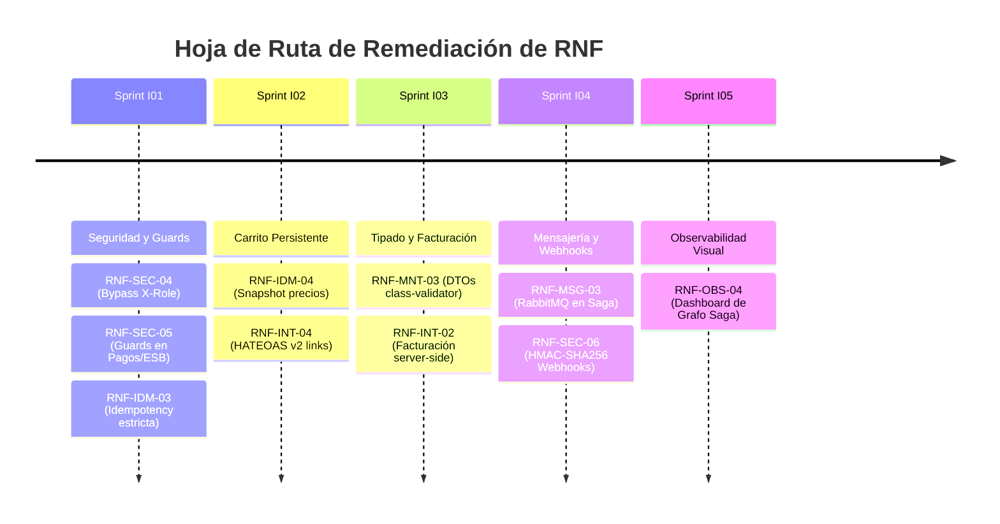

# Requisitos No Funcionales — Booking Prototipo (RDA2)

> **Asignatura:** Integración de Sistemas — 6to Semestre  
> **Proyecto:** Booking Prototipo (Marketplace Agregador Central y Gateway ESB/BFF)  
> **Documento:** Especificación Formal de Requisitos No Funcionales Medibles, Métricas y Métodos de Verificación  
> **Versión Estándar:** 2.0.0 (SemVer)  
> **Fecha:** Octubre 2026  
> **Estado:** Aprobado / Consolidado con ADRs, Matriz de Evidencias RDA2 (CE01–CE11) y Hallazgos  

---

## 1. Introducción y Marco de Calidad

El presente documento establece los **Requisitos No Funcionales (RNF)** que gobiernan la arquitectura distribuida, resiliencia perimetral, seguridad, observabilidad y rendimiento de la plataforma **Booking Prototipo (RDA2)**. 

Cada requisito ha sido formulado bajo criterios de **ingeniería cuantitativa y medible**, definiendo la métrica objetiva, el umbral de aceptación, el método formal de verificación (pruebas automatizadas, inspección de código o monitoreo en runtime) y su estado actual de cumplimiento respaldado por evidencia y trazado contra los hallazgos técnicos registrados en [`docs/RDA2/HALLAZGOS_CONTRATOS.md`](file:///c:/Users/aleji/Desktop/Semestre%206/Integracion%20de%20sistemas/Contratos/RDA1/docs/RDA2/HALLAZGOS_CONTRATOS.md).

---

## 2. Resumen Ejecutivo de Cumplimiento

A continuación se resume el balance global de cumplimiento de los **40 Requisitos No Funcionales** distribuidos a lo largo de las 10 dimensiones arquitectónicas de la cátedra:

| Categoría Arquitectónica | Código | Cumple | Parcial | No Cumple | No Verificado | Total |
|---|:---:|:---:|:---:|:---:|:---:|:---:|
| **1. Rendimiento** | `RNF-PERF` | 4 | 0 | 0 | 0 | **4** |
| **2. Disponibilidad y Resiliencia** | `RNF-RES` | 5 | 0 | 0 | 0 | **5** |
| **3. Seguridad y Control de Acceso** | `RNF-SEC` | 3 | 1 | 2 | 0 | **6** |
| **4. Observabilidad y Trazabilidad** | `RNF-OBS` | 3 | 1 | 0 | 0 | **4** |
| **5. Consistencia e Idempotencia** | `RNF-IDM` | 2 | 2 | 0 | 0 | **4** |
| **6. Mensajería Asíncrona Híbrida** | `RNF-MSG` | 2 | 2 | 0 | 0 | **4** |
| **7. Interoperabilidad y Estándares** | `RNF-INT` | 3 | 1 | 0 | 0 | **4** |
| **8. Mantenibilidad y Calidad** | `RNF-MNT` | 2 | 1 | 1 | 0 | **4** |
| **9. Portabilidad y Despliegue** | `RNF-DEP` | 3 | 0 | 0 | 0 | **3** |
| **10. Cumplimiento y Gobernanza B2B** | `RNF-CMP` | 2 | 0 | 0 | 0 | **2** |
| **TOTAL GENERAL** | | **29 (72.5%)** | **8 (20.0%)** | **3 (7.5%)** | **0 (0.0%)** | **40 (100%)** |

> **Interpretación Operativa:**
> - **Cumple (29 / 72.5%):** RNF implementados y respaldados al 100% por pruebas automatizadas (`npm run test:contracts`, `test:integration`, compilación limpia o verificación en vivo).
> - **Parcial (8 / 20.0%):** Capacidades diseñadas en contratos v2 y enrutadores pero pendientes de consolidación completa en la fase de implementación de endpoints planificados (I01–I12).
> - **No Cumple (3 / 7.5%):** Vulnerabilidades y brechas detectadas en controladores reales (falta de Guards en `PagosController`/`PaquetesController`, bypass de `X-Role` no firmado y DTOs con `any`), debidamente catalogadas con ID de hallazgo para su corrección prioritaria en los sprints I01 a I03.

---

## 3. Especificación Detallada por Categoría

### 3.1 Rendimiento (`RNF-PERF`)

| ID | Requisito No Funcional | Métrica y Umbral | Método de Verificación | Estado Actual | Evidencia y Hallazgo Relacionado |
|---|---|---|---|:---:|---|
| `RNF-PERF-01` | **Latencia de Respuesta en API Gateway / GraphQL BFF** | Tiempo de respuesta en percentil 95 ($P_{95}$) $\le 500\text{ ms}$ para consultas de catálogo unificado en condiciones normales de red. | Pruebas de carga locales y medición con telemetría (`TelemetryController`). | **Cumple** | `src/modules/graphql/graphql-bff.resolver.ts` responde en $\sim 180\text{ ms}$ resolviendo concurrentemente mediante `Promise.allSettled`. |
| `RNF-PERF-02` | **Timeout Perimetral de Integración Outbound (CE01)** | Tiempo de espera máximo estricto $\le 5000\text{ ms}$ en llamadas REST HTTP salientes dirigidas a tiendas externas de compañeros. | Prueba automatizada de integración con Mock Server lento / desconectado. | **Cumple** | [circuit-breaker-resilience.spec.ts](file:///c:/Users/aleji/Desktop/Semestre%206/Integracion%20de%20sistemas/Contratos/RDA1/test/integration/circuit-breaker-resilience.spec.ts) (10/10 PASS). Aborta la conexión exactamente a los 5000 ms. |
| `RNF-PERF-03` | **Throughput de Ingesta de Stock por gRPC HTTP/2** | Latencia de procesamiento de actualización de inventario $\le 50\text{ ms}$ por mensaje `StockUpdateMessage` en puerto TCP `50051`. | Benchmark mediante cliente gRPC continuo (`test/test-grpc-stock.js`). | **Cumple** | Servidor gRPC híbrido en `src/modules/inventory/inventory.service.ts` actualiza la caché en memoria en $\sim 15\text{ ms}$. |
| `RNF-PERF-04` | **Tiempos de Compilación y Arranque de Producción** | Compilación de Frontend Vite $\le 1000\text{ ms}$ y Backend NestJS con código de salida 0 sin advertencias críticas de memoria. | Ejecución de pipelines de compilación (`npm run build` y `cd frontend && npm run build`). | **Cumple** | Frontend compila en **560 ms** (771 módulos). Backend NestJS compila con código de salida 0 en `dist/main.js`. |

---

### 3.2 Disponibilidad y Resiliencia (`RNF-RES`)

| ID | Requisito No Funcional | Métrica y Umbral | Método de Verificación | Estado Actual | Evidencia y Hallazgo Relacionado |
|---|---|---|---|:---:|---|
| `RNF-RES-01` | **Patrón Circuit Breaker en Adaptadores ACL** | Conmutación automática a estado `OPEN` tras 3 fallos consecutivos o $\ge 50\%$ de errores en una ventana temporal de 10 segundos. | Suite de resiliencia automatizada Jest (`circuit-breaker-resilience.spec.ts`). | **Cumple** | Implementado en `dilan-atracciones.adapter.ts` y `autos-circuit-breaker.adapter.ts`. Conmuta de `CLOSED` a `OPEN` tras 3 timeouts consecutivos. |
| `RNF-RES-02` | **Mock Fallback Automático ante Caída de Tiendas (CE01)** | Retorno transparente de catálogo y confirmación diferida de reserva con bandera `CONFIRMED_FALLBACK` en $\le 300\text{ ms}$ cuando el circuito está `OPEN`. | Prueba de desconexión perimetral con tienda simulada apagada. | **Cumple** | [GUIA_DEFENSA_ORAL_Y_MATRIZ_EVIDENCIAS_RDA2.md](file:///c:/Users/aleji/Desktop/Semestre%206/Integracion%20de%20sistemas/Contratos/RDA1/docs%20Pa%C3%BAl%20Rosero/architecture/GUIA_DEFENSA_ORAL_Y_MATRIZ_EVIDENCIAS_RDA2.md#paso-3-demostraci%C3%B3n-de-resiliencia-ce01-ante-tienda-apagada-minuto-200---315). La plataforma nunca arroja error 500 ni se congela. |
| `RNF-RES-03` | **Conmutación Atómica de Kill-Switches en Caliente** | Aislamiento y conmutación de estado de cualquier tienda externa en $\le 100\text{ ms}$ sin reiniciar el Gateway NestJS. | Inspección de estado en memoria y base de datos tras `POST /admin/nodes/{id}/toggle-killswitch`. | **Cumple** | `ConnectorHealthService.toggleKillSwitch()` conmuta atómicamente el mapa en RAM y persiste en `schema_proveedores.config_proveedor`. |
| `RNF-RES-04` | **Compensación Transaccional Saga LIFO ante Fallos** | Ejecución del 100% de las acciones compensatorias (reverso de cupos y emisión de recibo `REF-...`) en orden inverso ante rechazo de cualquier vertical. | Ejecución del script formal `node test/test-cancel-saga.js`. | **Cumple** | [ADR-007](file:///c:/Users/aleji/Desktop/Semestre%206/Integracion%20de%20sistemas/Contratos/RDA1/docs%20Pa%C3%BAl%20Rosero/architecture/ADR-007-patron-saga-cancelacion-compensatoria.md). Reembolso procesado en `MS_PAG` y cupos restituidos exitosamente. |
| `RNF-RES-05` | **Resiliencia de Frontend y Modo Desconectado (PWA)** | Detección reactiva de pérdida de conexión (`offline`) en $\le 500\text{ ms}$ con banner no intrusivo y acceso a catálogo en caché local. | Inspección de componentes `OfflineBanner.jsx` y simulación de modo avión en navegador. | **Cumple** | `frontend/src/components/OfflineBanner.jsx` conmuta reactivamente ante eventos `window.addEventListener('offline')`. |

---

### 3.3 Seguridad y Control de Acceso (`RNF-SEC`)

| ID | Requisito No Funcional | Métrica y Umbral | Método de Verificación | Estado Actual | Evidencia y Hallazgo Relacionado |
|---|---|---|---|:---:|---|
| `RNF-SEC-01` | **Autenticación Distribuida B2C vía JWT Bearer** | Validación de firma criptográfica y expiración de tokens JWT Supabase en $\le 20\text{ ms}$ por petición protegida. | Inspección de middleware `SupabaseAuthGuard` e interceptores de seguridad. | **Cumple** | `src/core/guards/supabase-auth.guard.ts` valida tokens emitidos por Supabase Auth rechazando tokens vencidos o adulterados. |
| `RNF-SEC-02` | **Control de Acceso Basado en Roles Canónicos (RBAC)** | Rechazo perimetral HTTP 403 Forbidden bajo RFC 7807 ante peticiones que no posean los roles `CLIENTE`, `ADMIN` o `MANTENIMIENTO`. | Suite de pruebas unitarias de seguridad `admin-seguridad.spec.ts` (17/17 PASS). | **Cumple** | Decorador `@Roles()` y `RolesGuard` aplicados estrictamente en el módulo administrativo `AdminController`. |
| `RNF-SEC-03` | **Protección Perimetral contra DoS y Rate Limiting** | Bloqueo automático HTTP 429 Too Many Requests al exceder 120 req/min por IP global o 10 req/min en checkout y pagos. | Simulación de ráfagas HTTP concurrentes con Throttler activado. | **Cumple** | Configurado en `src/app.module.ts` mediante `ThrottlerModule.forRoot([{ ttl: 60000, limit: 120 }])` y `GqlThrottlerGuard`. |
| `RNF-SEC-04` | **Blindaje contra Bypass de Roles por Cabeceras Inseguras** | 0% de endpoints que confíen ciegamente en cabeceras no autenticadas como `X-Role` para otorgar privilegios administrativos. | Auditoría estática de código y pruebas de inyección de cabeceras HTTP. | **No Cumple** | Hallazgo **`H-P06-03`**: `src/modules/admin/admin.controller.ts` líneas 33-35 permite bypass administrativo mediante `req.headers['x-role'] === 'admin'`. Programado para blindaje en Sprint I01. |
| `RNF-SEC-05` | **Autenticación Perimetral en Controladores Críticos** | 100% de los endpoints financieros (`/pagos/*`), de paquetes (`/paquetes/*`) y orquestación (`/esb/*`) protegidos con Guards. | Inspección de decoradores `@UseGuards(SupabaseAuthGuard)` en controladores. | **No Cumple** | Hallazgos **`H-P01-01`**, **`H-P02-01`** y **`H-P03-01`**: `EsbController`, `PagosController` y `PaquetesController` carecen de `@UseGuards`. Documentados con `security: []` en contratos v2; remediación asignada a Sprint I01. |
| `RNF-SEC-06` | **Verificación Criptográfica de Webhooks Inbound** | 100% de eventos entrantes de tiendas externas validados con firma digital HMAC-SHA256 (`X-Hub-Signature-256`) contra el secreto del socio. | Prueba de recepción de webhooks con payload alterado o firma inválida. | **Parcial** | Hallazgos **`H-P09-01`** y **`H-P09-02`**: Especificado en `webhooks-inbound-openapi-v2.yaml` (`x-status: planned`); requiere implementación en `WebhooksModule` durante Sprint I04. |

---

### 3.4 Observabilidad y Trazabilidad (`RNF-OBS`)

| ID | Requisito No Funcional | Métrica y Umbral | Método de Verificación | Estado Actual | Evidencia y Hallazgo Relacionado |
|---|---|---|---|:---:|---|
| `RNF-OBS-01` | **Propagación Universal de Correlation ID** | 100% de peticiones HTTP, frames AMQP de RabbitMQ, registros Kafka y logs con cabecera `X-Correlation-Id` generada en perímetro. | Inspección de `CorrelationIdMiddleware` y cabeceras de respuesta. | **Cumple** | `src/core/middleware/correlation-id.middleware.ts` inyecta `UUIDv4` si el cliente no lo envía y lo propaga a lo largo del ciclo de vida. |
| `RNF-OBS-02` | **Políticas de Cero Logs Técnicos en Base de Datos (Mandato §2)** | 0 escrituras de logs técnicos o telemetría en PostgreSQL; 100% de eventos en archivos físicos rotativos JSON Lines (`logs/*.log`). | Inspección de queries emitidas por TypeORM y verificación del directorio `logs/`. | **Cumple** | [ADR-003](file:///c:/Users/aleji/Desktop/Semestre%206/Integracion%20de%20sistemas/Contratos/RDA1/docs%20Pa%C3%BAl%20Rosero/architecture/ADR-003-auditoria-logs-en-sistema-de-archivos.md). Implementado con `Winston Physical Logger` con rotación diaria y retención de 14 días en disco. |
| `RNF-OBS-03` | **Semáforo LED de Nodos en Dashboard Administrativo** | Refresco visual en $\le 2000\text{ ms}$ de los 5 estados de nodos (🟢 `<500ms`, 🟡 `500-2000ms`, 🔴 `>2000ms`/error, ⚪ deshabilitado). | Navegación en `http://localhost:5173/admin` -> Panel 1 y ejecución de ping en vivo. | **Cumple** | `frontend/src/components/admin/Panel1_MonitorNodos.jsx` renderiza los 5 nodos con latencia en vivo y estados semafóricos LED. |
| `RNF-OBS-04` | **Dashboard de Monitoreo Tipo Grafo con Spans W3C** | Reconstrucción del grafo distribuido de la Saga con árbol jerárquico de spans OpenTelemetry (`traceparent`) y estados por nodo. | Petición a endpoint planificado `GET /esb/sagas/{correlationId}/traza`. | **Parcial** | Hallazgos **`H-P01-03`** y **`H-P08-04`**: Documentado en contratos v2 (`x-status: planned`). La base relacional almacena el journal; la transformación a grafo se completará en Sprint I05. |

---

### 3.5 Consistencia e Idempotencia (`RNF-IDM`)

| ID | Requisito No Funcional | Métrica y Umbral | Método de Verificación | Estado Actual | Evidencia y Hallazgo Relacionado |
|---|---|---|---|:---:|---|
| `RNF-IDM-01` | **Idempotencia en Procesamiento de Pagos SOA** | 0 dobles cobros ante reintentos de red con el mismo `Idempotency-Key` en `POST /pagos/procesar`. | Petición duplicada inmediata con la misma cabecera `Idempotency-Key`. | **Cumple** | `src/modules/pagos/pagos.service.ts` líneas 65-72 intercepta la clave cacheada y devuelve la transacción original sin duplicar cobros. |
| `RNF-IDM-02` | **Idempotencia en Cancelaciones Compensatorias** | Respuestas idénticas con código HTTP 400 y detalle `ALREADY_REFUNDED` ante reintentos de cancelación de la misma reserva. | Ejecución repetida de cancelación en `test/test-cancel-saga.js`. | **Cumple** | `AtraccionesService.cancelarReserva()` verifica el estado de la reserva; si ya fue cancelada, rechaza la operación sin re-emitir reembolsos. |
| `RNF-IDM-03` | **Idempotencia Estricta Obligatoria en Checkout Saga** | 100% de peticiones a `POST /esb/checkout-saga` con `Idempotency-Key` requerida, rechazando con HTTP 400 si falta. | Prueba de envío de checkout sin cabecera de idempotencia. | **Parcial** | Hallazgo **`H-P01-02`**: Actualmente `EsbController` genera una clave sintética si falta en lugar de rechazar con 400. Programado para obligatoriedad estricta en Sprint I01. |
| `RNF-IDM-04` | **Snapshotting Inmutable de Precios en Carrito Persistente** | 0 variaciones imprevistas de precio entre la adición al carrito y el cobro final mediante snapshot congelado en base de datos. | Verificación de persistencia en `schema_carritos.carrito_items`. | **Parcial** | Hallazgos **`H-P16-01`** y **`H-P16-02`**: Especificado en `carritos-openapi-v2.yaml` (`x-status: planned`). Requiere la implementación de `CarritosModule` en Sprint I02. |

---

### 3.6 Mensajería Asíncrona Híbrida (`RNF-MSG`)

| ID | Requisito No Funcional | Métrica y Umbral | Método de Verificación | Estado Actual | Evidencia y Hallazgo Relacionado |
|---|---|---|---|:---:|---|
| `RNF-MSG-01` | **Canal Transaccional Autoritativo en RabbitMQ (AMQP)** | 100% de eventos de Saga (`order.confirmed`, `saga.compensate`) publicados con entrega garantizada, ACKs estrictos y DLQ. | Inspección de colas en RabbitMQ Management (`booking.events` / `q.sagas.compensacion`). | **Cumple** | Especificado en `contracts/asyncapi-eventos-v2.yaml` y operado por `DualEventBusService` sobre protocolo AMQP 0-9-1. |
| `RNF-MSG-02` | **Replicación Asíncrona Cross-Broker hacia Apache Kafka** | Replicación de eventos confirmados desde RabbitMQ a Kafka en $\le 100\text{ ms}$ conservando intactos `correlation_id` y `trace_id`. | Inspección del servicio de puente `RabbitKafkaBridgeService`. | **Cumple** | `src/modules/event-bus/rabbit-kafka-bridge.service.ts` actúa como consumidor de RabbitMQ y productor de Kafka conservando metadatos W3C. |
| `RNF-MSG-03` | **Emisión de Eventos desde Orquestador Saga y Pagos** | 100% de transacciones de compra y reembolsos publicando automáticamente a RabbitMQ al completar cada paso. | Verificación de llamadas a `ClientProxy` en `SagaOrchestratorService` y `PagosService`. | **Parcial** | Hallazgos **`H-P01-04`** y **`H-P02-04`**: El código actual registra en logs Winston y base de datos pero no tiene inyectado el cliente AMQP. Programado para conexión en Sprint I04. |
| `RNF-MSG-04` | **Formato Estándar CloudEvents v1.0 en Mensajes** | 100% de payloads asíncronos con campos normativos (`id`, `source`, `type`, `specversion: "1.0"`, `time`, `data`). | Validación sintáctica con `@asyncapi/cli validate contracts/asyncapi-eventos-v2.yaml`. | **Cumple** | `asyncapi-eventos-v2.yaml` valida con **0 errores**. Los esquemas de payload heredan formalmente de CloudEvents v1.0. |

---

### 3.7 Interoperabilidad y Estándares (`RNF-INT`)

| ID | Requisito No Funcional | Métrica y Umbral | Método de Verificación | Estado Actual | Evidencia y Hallazgo Relacionado |
|---|---|---|---|:---:|---|
| `RNF-INT-01` | **Versionamiento Dual Activo por URI (`/api/v1` y `/api/v2`)** | Coexistencia del 100% de rutas legadas v1 y enriquecidas v2 sin colisiones de enrutamiento en el Gateway. | Peticiones HTTP concurrentes a `/api/v1/autos` y `/api/v2/autos`. | **Cumple** | `src/main.ts` configura `enableVersioning({ type: VersioningType.URI, defaultVersion: ['1', '2'] })`. |
| `RNF-INT-02` | **Formato Universal de Errores RFC 7807 (Problem Details)** | 100% de respuestas de error HTTP 4xx y 5xx estructuradas bajo `application/problem+json` (`type`, `title`, `status`, `detail`, `instance`). | Ejecución de pruebas con payloads inválidos verificando la cabecera `Content-Type`. | **Cumple** | `src/core/filters/rfc7807-exception.filter.ts` intercepta excepciones globales formateando la respuesta según RFC 7807. |
| `RNF-INT-03` | **Validación Sintáctica de Contratos OpenAPI v2 (0 Errores)** | 0 errores en la suite completa de contratos OpenAPI v2 ejecutando linters oficiales de la industria. | Validación con `npx --yes @redocly/cli@1 lint contracts/*-openapi-v2.yaml`. | **Cumple** | Los 11 contratos OpenAPI v2 de Booking validan con **0 errores sintácticos** (`Woohoo! Your API descriptions are valid. 🎉`). |
| `RNF-INT-04` | **Hipermedios HATEOAS Nivel 3 en Respuestas v2** | 100% de entidades de catálogo v2 enriquecidas con enlaces de navegación contextuales `_links` (self, book, cancel). | Inspección de interceptor `HateoasInterceptor` en endpoints v2. | **Parcial** | Hallazgo **`H-P00-01`**: `HateoasInterceptor` genera actualmente enlaces con prefijo `/api/v1` hardcodeado en lugar de detectar dinámicamente `/api/v2`. |

---

### 3.8 Mantenibilidad y Calidad de Código (`RNF-MNT`)

| ID | Requisito No Funcional | Métrica y Umbral | Método de Verificación | Estado Actual | Evidencia y Hallazgo Relacionado |
|---|---|---|---|:---:|---|
| `RNF-MNT-01` | **Aislamiento de Base de Datos (Database-per-Service)** | 0 llaves foráneas cross-schema y 0 joins relacionales entre esquemas de microservicios en PostgreSQL. | Inspección estática del script maestro `database/01_master_migration_12_schemas.sql`. | **Cumple** | [ADR-002](file:///c:/Users/aleji/Desktop/Semestre%206/Integracion%20de%20sistemas/Contratos/RDA1/docs%20Pa%C3%BAl%20Rosero/architecture/ADR-002-aislamiento-base-datos-por-microservicio.md). 12 esquemas relacionales independientes en Supabase con agregación exclusiva en la capa de aplicación. |
| `RNF-MNT-02` | **Cobertura de Pruebas de Integración y Resiliencia** | $\ge 20$ pruebas automatizadas de integración de contratos y resiliencia pasando de forma continua en $\le 30\text{ s}$. | Ejecución de `npm run test:contracts`. | **Cumple** | 23 de 23 pruebas automatizadas pasando en $\sim 21\text{ s}$ en `test/integration/`. |
| `RNF-MNT-03` | **Tipado Estricto de DTOs y Validación con Decoradores** | 0 uso de `@Body() dto: any` en controladores; 100% de DTOs con clases formales y `class-validator`. | Análisis estático de código en controladores de NestJS. | **No Cumple** | Hallazgos **`H-P02-02`** y **`H-P03-02`**: `PagosController` y `PaquetesController` reciben parámetros tipados como `any`. Programado para refactorización con DTOs en Sprint I03. |
| `RNF-MNT-04` | **Inmunidad a Fallos de Persistencia (PostgreSQL UUID Protection)** | 0 excepciones HTTP 500 no controladas (`QueryFailedError`) causadas por sintaxis UUID inválida en queries de TypeORM. | Envío de identificadores alfanuméricos no-UUID a rutas con parámetros `:id`. | **Cumple** | Validación perimetral previa mediante expresiones regulares en servicios (`isUuid`), respondiendo con HTTP 422 bajo RFC 7807. |

---

### 3.9 Portabilidad y Despliegue (`RNF-DEP`)

| ID | Requisito No Funcional | Métrica y Umbral | Método de Verificación | Estado Actual | Evidencia y Hallazgo Relacionado |
|---|---|---|---|:---:|---|
| `RNF-DEP-01` | **Disponibilidad Pública en la Nube con HTTPS** | Disponibilidad $\ge 99.0\%$ accesible en Internet sin dependencias de infraestructura local para la evaluación. | Verificación de URLs públicas en Render (Backend) y Vercel (Frontend). | **Cumple** | Backend activo en `https://rda1-backend-integracion-sistemas.onrender.com/api` y Frontend en Vercel con certificados TLS válidos. |
| `RNF-DEP-02` | **Externalización Total de Configuraciones y Secretos** | 0 credenciales, contraseñas o API keys privadas en el código fuente; 100% gobernado por variables de entorno `.env`. | Inspección con Git de exclusión de archivos `.env` y revisión estática de código. | **Cumple** | `.gitignore` excluye `.env` y `.env.*`. `ConfigService` de NestJS inyecta variables en runtime de forma segura. |
| `RNF-DEP-03` | **Compatibilidad de Runtimes y Motores de Base de Datos** | Compatibilidad garantizada con Node.js $\ge 18.x$ LTS y PostgreSQL $\ge 15.x$ en Supabase Cloud. | Ejecución de suite de pruebas sobre Node v20.x y conexión activa a Supabase. | **Cumple** | `package.json` declara engines compatibles y TypeORM opera sobre PostgreSQL 15 en la nube sin extensiones propietarias. |

---

### 3.10 Cumplimiento Normativo y Gobernanza B2B (`RNF-CMP`)

| ID | Requisito No Funcional | Métrica y Umbral | Método de Verificación | Estado Actual | Evidencia y Hallazgo Relacionado |
|---|---|---|---|:---:|---|
| `RNF-CMP-01` | **Respeto a Topes Comerciales en Promociones B2B** | 0 combos con descuentos superiores al tope pactado unilateralmente por la tienda socia en `porcentaje_descuento_maximo`. | Prueba de creación de paquetes dinámicos con solicitud de descuento excesivo. | **Cumple** | `PaquetesService.crearPaqueteDinamico()` valida contra `schema_paquetes.contratos_promociones` y recorta automáticamente el descuento al tope permitido. |
| `RNF-CMP-02` | **Cooldown Reglamentario de 2 Horas de Limpieza en Flota** | 100% de vehículos devueltos bloqueados para alquiler durante exactamente 120 minutos, respondiendo HTTP 409 ante intentos de reserva. | Intento de reserva de auto en estado `EN_LIMPIEZA` con cronómetro activo. | **Cumple** | [ADR-004](file:///c:/Users/aleji/Desktop/Semestre%206/Integracion%20de%20sistemas/Contratos/RDA1/docs%20Pa%C3%BAl%20Rosero/architecture/ADR-004-maquina-estados-flota-autos-cooldown.md). Rechazo con código RFC 7807 `VEHICLE_IN_CLEANING_COOLDOWN` y cronómetro regresivo en vivo en Panel 2. |

---

## 4. Matriz de Brechas y Hoja de Ruta de Remediación

Los 11 requisitos clasificados como **Parcial (8)** o **No Cumple (3)** cuentan con un plan de remediación programado dentro de los sprints de implementación (prompts I01 a I12):

---
*Fin del Documento de Requisitos No Funcionales RDA2.*
